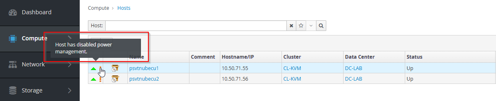
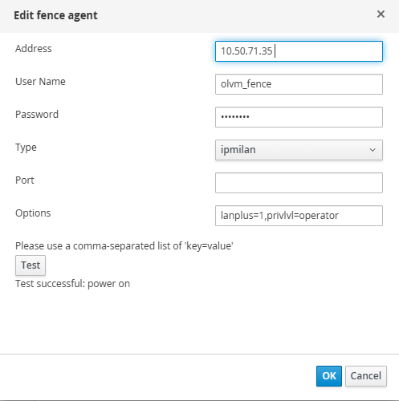
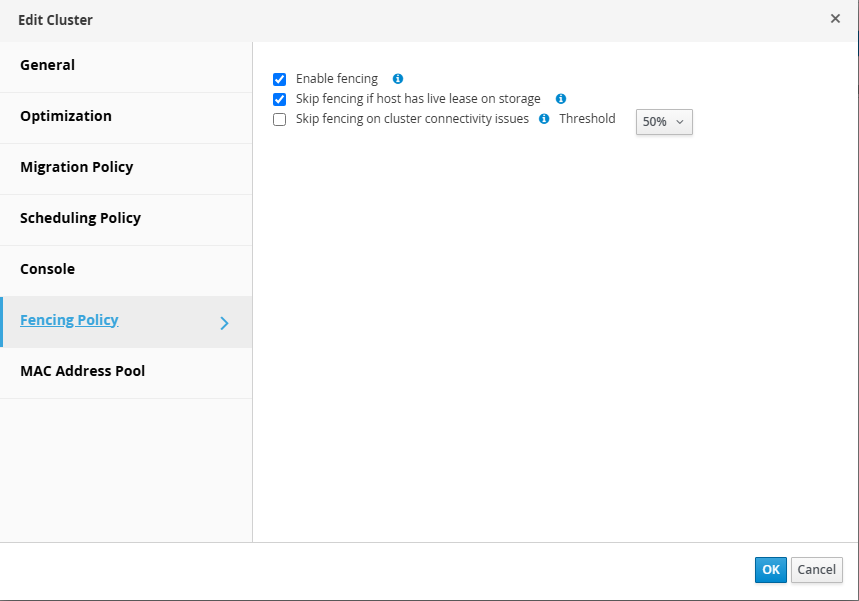
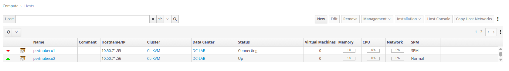
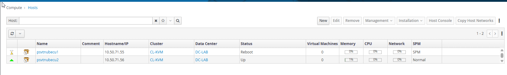
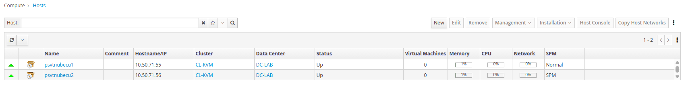

This guide demonstrates how to configure **host fencing in Oracle Linux Virtualization Manager (OLVM)** using **Oracle Integrated Lights Out Manager (ILOM) 5.1.0.23** and the IPMI fencing agent.

Host fencing is an important component of high availability in a virtualization environment. It enables OLVM to control the power state of a KVM host through an out-of-band management interface when the host becomes unresponsive or cannot be managed normally.



In this example, Oracle ILOM is used as the power management interface, and the `ipmilan` fencing agent is configured in OLVM.

The configuration includes verifying the prerequisites, enabling IPMI access, checking network connectivity, testing the fencing agent, and configuring power management in OLVM.

## Prerequisites

Before configuring fencing, verify that the following requirements are met:

- Oracle Linux Virtualization Manager is installed and operational.
- The Oracle Linux KVM hosts are registered in OLVM.
- The target physical server provides an Oracle ILOM management interface.
- Oracle ILOM firmware version **5.1.0.23** is installed in this example.
- The ILOM management IP address is configured and accessible.
- At least one additional KVM host is available to act as a fencing proxy.
- Network connectivity is available between the fencing proxy and the target host's ILOM interface.
- UDP port **623** is permitted between the fencing proxy and ILOM.
- A dedicated ILOM user with appropriate power management privileges is available.
- The `fence_ipmilan` fencing agent is installed on the KVM hosts that can act as fencing proxies.

OLVM uses a fencing proxy to communicate with the power management interface of another host. The fencing operation is therefore initiated from an eligible KVM host rather than directly from the OLVM Manager.

For additional information, refer to the [Oracle Linux Virtualization Manager Administrator's Guide](https://docs.oracle.com/en/virtualization/oracle-linux-virtualization-manager/admin/admin-optimize-clus-host-vm.html).

## Verify Oracle ILOM Firmware Version

Connect to the Oracle ILOM management interface using SSH:

```bash
[root@psvtnubecu1 ~]# ssh root@10.50.71.35
```

After logging in, verify the installed firmware version:

```text
Oracle(R) Integrated Lights Out Manager

Version 5.1.0.23 r146986

Copyright (c) 2022, Oracle and/or its affiliates. All rights reserved.

Warning: password is set to factory default.

Warning: HTTPS certificate is set to factory default.

Hostname: psvtnubecu1-ilom

-> version
SP firmware 5.1.0.23
SP firmware build number: 146986
SP firmware date: Thu Aug  4 20:11:49 PDT 2022
SP filesystem version: 0.4.210615
```

For this demonstration, the server uses **Oracle ILOM 5.1.0.23**.

The available management commands and configuration properties can vary depending on the Oracle server model and installed ILOM firmware.

## Verify IPMI Configuration in Oracle ILOM

The `ipmilan` fencing agent communicates with the server's management controller using IPMI.

For IPMI 2.0 LAN+ communication, the corresponding IPMI service and session settings must be enabled in Oracle ILOM.

Connect to the ILOM CLI and check the current configuration:

```text
-> show /SP/services/ipmi

 /SP/services/ipmi
    Targets:

    Properties:
        servicestate = enabled
        tls_sessions = enabled
        v2_0_sessions = enabled

    Commands:
        cd
        set
        show
```

If the IPMI service is disabled, enable it:

```text
-> set /SP/services/ipmi state=enabled
```

If the IPMI 2.0 sessions service is disabled, enable it:

```text
-> set /SP/services/ipmi v2_0_sessions=enabled
```

Verify the configuration again:

```text
-> show /SP/services/ipmi
```

Starting with Oracle ILOM 5.0, IPMI 2.0 sessions are disabled by default. They must be explicitly enabled when required by management applications that use IPMI 2.0.

IPMI 2.0 should only be enabled on a restricted management network. Oracle also provides more secure management interfaces, including IPMI over TLS, but the standard OLVM `ipmilan` agent uses the IPMI LAN protocol.

For additional information, refer to the [Oracle ILOM 5.1 IPMI Configuration Documentation](https://docs.oracle.com/en/servers/management/ilom/5.1.x/protocol-guide/set-ipmi-state-and-session-properties-cli.html).

## Create an Oracle ILOM User for Fencing

Before configuring host fencing in Oracle Linux Virtualization Manager, create a dedicated Oracle ILOM user for IPMI-based power management operations.

For this demonstration, the user `olvm_fence` is created with the **Operator** role.

Oracle ILOM provides predefined user roles for controlling access to management functions. The Operator role (`cro`) includes console management, reset and host control, and read-only privileges.

According to Oracle's IPMI documentation, the IPMI Operator role provides access to remote power management functions without requiring full administrative privileges.

Connect to the Oracle ILOM CLI using an account with user management permissions.

Display the existing local users:

```text
-> show /SP/users

 /SP/users
    Targets:
        root
        MSUser

    Properties:

    Commands:
        cd
        create
        delete
        set
        show
```

Create a dedicated fencing account:

```text
-> create /SP/users/olvm_fence
Creating user...
Enter new password: ********
Enter new password again: ********
Created /SP/users/olvm_fence
```

Enter and confirm the password when prompted.

Assign the Operator role:

```text
-> set /SP/users/olvm_fence role=cro
Set 'role' to 'cro'
```

The assigned roles are:

- `c` — Console management
- `r` — Reset and host control
- `o` — Read-only access

The Operator role provides the privileges needed for IPMI power management without granting general ILOM administration or user management permissions.

Verify the account configuration:

```text
-> show /SP/users/olvm_fence

 /SP/users/olvm_fence
    Targets:
        ssh

    Properties:
        role = cro
        password = *****
        locked = false

    Commands:
        cd
        set
        show
```

Confirm that the configured role is:

```text
role = cro
```

The `olvm_fence` account will be used when configuring the `ipmilan` fencing agent in OLVM.

For production environments, use a dedicated account for fencing, restrict access to the ILOM management network, and manage credentials according to the organization's security policies.

The fencing account should be created on each Oracle ILOM interface associated with an OLVM KVM host that requires power management.

For additional information, refer to the following Oracle documentation:

- [Oracle ILOM 5.1 — Add New Users](https://docs.oracle.com/en/servers/management/ilom/5.1.x/get-started/add-new-users-oracle-ilom.html)
- [Oracle ILOM 5.1 — Assignable User Roles](https://docs.oracle.com/en/servers/management/ilom/5.1.x/admin-guide/assignable-oracle-ilom-user-roles.html)
- [Oracle ILOM 5.1 — IPMI Protocol Management Reference](https://docs.oracle.com/en/servers/management/ilom/5.1.x/protocol-guide/oracle-ilom-protocol-management-reference-snmp-and-ipmi-firmware-release-5.1-x.pdf)

## Verify Network Connectivity

Before configuring fencing in OLVM, verify that another KVM host can communicate with the target server's ILOM interface.

Connect to an available KVM host that can act as the fencing proxy:

```bash
[root@psvtnubecu1 ~]# ip route get 10.50.71.35
10.50.71.35 dev ovirtmgmt table 329647082 src 10.50.71.56 uid 0
    cache
```

This command displays the network route used to reach the ILOM management address.

Test basic network connectivity:

```bash
[root@psvtnubecu1 ~]# ping -c 4 10.50.71.35
PING 10.50.71.35 (10.50.71.35) 56(84) bytes of data.
64 bytes from 10.50.71.35: icmp_seq=1 ttl=64 time=0.750 ms
64 bytes from 10.50.71.35: icmp_seq=2 ttl=64 time=0.687 ms
64 bytes from 10.50.71.35: icmp_seq=3 ttl=64 time=0.679 ms
64 bytes from 10.50.71.35: icmp_seq=4 ttl=64 time=0.688 ms

--- 10.50.71.35 ping statistics ---
4 packets transmitted, 4 received, 0% packet loss, time 3074ms
rtt min/avg/max/mdev = 0.679/0.701/0.750/0.028 ms
```

If ICMP is permitted, the ILOM interface should respond to the ping requests.

However, a successful ping does not confirm that IPMI communication is working.

The IPMI LAN protocol uses UDP port **623**. Verify that network firewalls and access control lists permit this traffic between the fencing proxy and the ILOM management interface.

For environments with multiple KVM hosts, verify connectivity from each host that may be selected as a fencing proxy.

## Verify the Required Packages

On the KVM host, check whether the required IPMI tools and fencing agent are installed:

```bash
[root@psvtnubecu1 ~]# rpm -q ipmitool
ipmitool-1.8.18-27.el9.x86_64
[root@psvtnubecu1 ~]# rpm -q fence-agents-ipmilan
fence-agents-ipmilan-4.10.0-110.el9_8.7.noarch
```

If the packages are not installed, install them using the configured Oracle Linux repositories:

```bash
[root@kvm-host02 ~]# dnf install -y ipmitool fence-agents-ipmilan
```

Verify that the fencing agent is available:

```bash
[root@psvtnubecu1 ~]# command -v fence_ipmilan
/usr/sbin/fence_ipmilan
```

Display the supported fencing agent parameters:

```bash
[root@kvm-host02 ~]# fence_ipmilan --help
```

The available parameters depend on the installed version of the fencing agent.

## Test IPMI Connectivity

Before configuring fencing in OLVM, test IPMI communication directly from the fencing proxy.

Use the `ipmitool` utility to query the power state of the target server:

```bash
[root@psvtnubecu1 ~]# ipmitool -I lanplus \
  -H 10.50.71.35 \
  -U olvm_fence \
  -L OPERATOR \
  -a chassis power status
Password:
Chassis Power is on
```

The `-I lanplus` option selects IPMI 2.0 LAN+ communication.

The `-a` option prompts for the account password.

The `-L` option specifies the IPMI session privilege level.

A successful response should be similar to:

```text
Chassis Power is on
```

This confirms that the KVM host can communicate with the ILOM interface and query the server's power state.

If the command fails with an IPMI session error, verify the following:

- IPMI 2.0 sessions are enabled in Oracle ILOM.
- The ILOM management IP address is reachable.
- UDP port 623 is permitted.
- The username and password are correct.
- The ILOM user has sufficient privileges.
- The IPMI cipher suite is supported by the ILOM firmware and client.

The successful execution of this command does not necessarily confirm that the account has permission to perform power-off or reboot operations.

## Test the IPMI Fencing Agent

After verifying connectivity with `ipmitool`, test the fencing agent directly.

Run the following command from the fencing proxy:

```bash
[root@psvtnubecu1 ~]# read -rsp "ILOM password: " ILOM_PASS
echo

fence_ipmilan \
  -a 10.50.71.35 \
  -l olvm_fence \
  -o status \
  -P \
  -L operator \
  -p "$ILOM_PASS" \
  -v

unset ILOM_PASS

ILOM password:
2026-10-17 10:04:16,547 INFO: Executing: /usr/bin/ipmitool -I lanplus -H 10.50.71.35 -p 623 -U olvm_fence -P [set] -L OPERATOR -N 2 chassis power status

2026-10-17 10:04:16,735 DEBUG: 0 Chassis Power is on


Status: ON
```

The `-P` option enables IPMI 2.0 LAN+ communication.

Supply the password using a supported secure password mechanism for the installed agent version.

A successful response should be similar to:

```text
Status: ON
```

The output confirms that the fencing agent can communicate with the target server's management interface.

The `status` operation is non-disruptive and does not change the server's power state.

Do not execute fencing operations such as `off` or `reboot` against a production host without an approved maintenance window.

## Configure Power Management in OLVM

After verifying IPMI communication, configure the fencing agent in the OLVM Administration Portal.

Navigate to:

**Compute → Hosts**

Select the KVM host that requires fencing configuration and click **Edit**.

Open the **Power Management** tab.

Enable the **Enable Power Management** option.

Click **Add Fence Agent** and configure the following parameters:

| Parameter | Value |
|---|---|
| Address | ILOM management IP address |
| User Name | `olvm_fence` |
| Password | ILOM user password |
| Type | `ipmilan` |
| Port | Default |
| Slot | Empty |
| Options | `lanplus=1,privlvl=operator` |
| Secure | Enabled |

The `ipmilan` fencing agent communicates with the target server through the Oracle ILOM management interface using IPMI.

The following configuration is used in the **Options** field:

```text
lanplus=1,privlvl=operator
```

The options have the following purposes:

- `lanplus=1` — Enables IPMI 2.0 LAN+ communication.
- `privlvl=operator` — Configures the IPMI session to use the Operator privilege level, matching the permissions assigned to the `olvm_fence` account in Oracle ILOM.

The Operator privilege level is required in this example because the dedicated ILOM fencing account was configured with the `cro` role.

Without explicitly specifying the privilege level, the fencing agent may attempt to establish an IPMI session using the default Administrator privilege level, resulting in an authentication or session establishment failure.

The options are supplied as comma-separated `key=value` pairs.

After configuring the fencing agent, click **Test** to verify communication with the Oracle ILOM management interface.

A successful test should return a message similar to:

```text
Test Succeeded, Host Status is: on
```



This confirms that OLVM can retrieve the physical server's power state through the configured fencing agent.

Save the configuration by clicking **OK**.

Repeat the procedure for each KVM host that requires fencing, using the corresponding Oracle ILOM management IP address.

For additional information, refer to the [Oracle Linux Virtualization Manager Power Management Documentation](https://docs.oracle.com/en/virtualization/oracle-linux-virtualization-manager/admin/admin-optimize-clus-host-vm.html).


## Verify Fencing Health Checks

Oracle Linux Virtualization Manager provides a power management health check mechanism that periodically verifies the configured fencing interfaces.

These checks can help identify connectivity or configuration problems before a fencing operation is required.

On the OLVM Manager, check whether fencing health checks are enabled:

```bash
[root@psvtnubecu1 ~]# engine-config -g PMHealthCheckEnabled
```

In this example, the health checks are initially disabled:

```text
PMHealthCheckEnabled: false version: general
```

Check the configured health check interval:

```bash
[root@psvtnubecu1 ~]# engine-config -g PMHealthCheckIntervalInSec
```

The output shows:

```text
PMHealthCheckIntervalInSec: 3600 version: general
```

The interval is specified in seconds. A value of `3600` means that the health checks are scheduled every **60 minutes**.

Enable the fencing health checks:

```bash
[root@psvtnubecu1 ~]# engine-config -s PMHealthCheckEnabled=True
```

Verify the updated configuration:

```bash
[root@psvtnubecu1 ~]# engine-config -g PMHealthCheckEnabled
PMHealthCheckEnabled: true version: general
```

Restart the OLVM Manager service to apply the configuration change:

```bash
[root@psvtnubecu1 ~]# systemctl restart ovirt-engine
```

Verify that the service is running:

```bash
● ovirt-engine.service - oVirt Engine
     Loaded: loaded (/usr/lib/systemd/system/ovirt-engine.service; enabled; preset: disabled)
     Active: active (running) since Sat 2026-10-17 10:17:22 CEST; 3s ago
   Main PID: 256002 (ovirt-engine.py)
      Tasks: 48 (limit: 45913)
     Memory: 270.1M (peak: 270.1M)
        CPU: 6.046s
     CGroup: /system.slice/ovirt-engine.service
             ├─256002 /usr/bin/python3 /usr/share/ovirt-engine/services/ovirt-engine/ovirt-engine.py --redirect-output --systemd=notify start
             └─256048 ovirt-engine --add-modules java.se --add-modules java.naming --add-modules jdk.naming.dns --add-exports java.naming/com.sun.jndi.ldap=ALL-UNNAMED --add-exports jdk.naming.dns/com.sun.>

Oct 17 10:17:22 labor.vie.dbconcepts.at systemd[1]: Starting oVirt Engine...
Oct 17 10:17:22 labor.vie.dbconcepts.at systemd[1]: Started oVirt Engine.
Oct 17 10:17:22 labor.vie.dbconcepts.at ovirt-engine.py[256002]: 2026-10-17 10:17:22,425+0200 ovirt-engine: INFO _detectJBossVersion:183 Detecting JBoss version. Running: /usr/lib/jvm/jre-21/bin/java ['ovi>
Oct 17 10:17:23 labor.vie.dbconcepts.at ovirt-engine.py[256002]: 2026-10-17 10:17:23,529+0200 ovirt-engine: INFO _detectJBossVersion:202 Return code: 0,  | stdout: '['WildFly Full 24.0.1.Final (WildFly Cor>
```

The service should return an `active (running)` status.

Restarting the OLVM Manager temporarily interrupts management operations but does not normally affect the execution of existing virtual machines.

After the service restart, OLVM can periodically check the configured power management interfaces using the specified interval.

These checks provide an additional mechanism for identifying fencing communication issues, but they do not replace a controlled validation of actual fencing operations.

## Test Automatic Host Fencing (Destructive Test)

This test demonstrates automatic hardware fencing in Oracle Linux Virtualization Manager (OLVM) by deliberately triggering a **Linux kernel panic** on a KVM host.

The objective is to verify that OLVM detects the failed host, uses the remaining KVM host as a fencing proxy, powers the failed server off and back on through Oracle ILOM, and detects the host returning to service.

> **Warning:** This is a destructive test. Perform it only in an isolated lab or approved maintenance window. Ensure the target host has no running virtual machines, verify storage and SPM safety, and confirm independent ILOM access before proceeding.

### 1. Test Environment

| Component | Configuration |
|---|---|
| OLVM Manager | `labor` (`10.50.71.54`) |
| Target KVM host | `psvtnubecu1` (`10.50.71.55`) |
| Fencing proxy | `psvtnubecu2` (`10.50.71.56`) |
| Target Oracle ILOM | `10.50.71.35` |
| Fencing agent | `ipmilan` |
| Fencing user | `olvm_fence` |
| Fencing options | `privlvl=operator, lanplus=1` |
| Cluster size | 2 KVM hosts |

OLVM uses `psvtnubecu2` as the fencing proxy to execute IPMI power-management commands against the Oracle ILOM of `psvtnubecu1`.

### 2. Configure the Cluster Fencing Policy

Before performing the destructive test, verify that automatic fencing is enabled and that the cluster fencing policy allows the failed host to be restarted.

In OLVM, navigate to:

**Compute → Clusters → Select Cluster → Edit → Fencing Policy**

The following settings were used for the test:

| Setting | Value |
|---|---|
| Enable fencing | Enabled |
| Skip fencing if host has live lease on storage | Enabled |
| Skip fencing on cluster connectivity issues | Disabled |
| Connectivity threshold | 50% (inactive while the option is disabled) |

#### Why disable the 50% connectivity check?

The test environment consists of only **two KVM hosts**. If one host becomes unreachable, OLVM may consider this a connectivity issue affecting 50% of the cluster.

When **Skip fencing on cluster connectivity issues** is enabled with a threshold of 50%, OLVM can skip hardware fencing to protect against possible network partitions.

For this controlled lab test, the option was disabled so that the connectivity-percentage safeguard would not block the intended automatic fencing operation.

To configure this setting:

1. Navigate to **Compute → Clusters**.
2. Select the cluster and click **Edit**.
3. Open **Fencing Policy**.
4. Ensure **Enable fencing** is checked.
5. Uncheck **Skip fencing on cluster connectivity issues**.
6. Leave **Skip fencing if host has live lease on storage** enabled.
7. Click **OK** to save.



> **Warning:** Disabling the connectivity safeguard increases the risk of inappropriate fencing during a network partition. This change should only be used in an isolated lab or approved test environment. It does not bypass other storage-safety checks.

#### Restore the Original Policy

After completing the fencing test, return to **Compute → Clusters → Edit → Fencing Policy** and restore the original connectivity safeguard settings.

For this two-host cluster, if the original configuration was enabled with a 50% threshold, restore:

- **Skip fencing on cluster connectivity issues:** Enabled
- **Threshold:** 50%

Keep **Enable fencing** enabled and verify that both hosts and the storage domains are healthy.

### 4. Prepare and Trigger the Kernel Crash

Before triggering the crash, verify that:

- No virtual machines are running on `psvtnubecu1`.
- The second host, `psvtnubecu2`, is healthy.
- The storage domains are accessible and the target host is not holding an unsafe SPM/storage responsibility.
- Power Management is enabled and the ILOM is reachable.
- The cluster fencing policy allows the intended recovery operation.
- Independent console or ILOM recovery is available.

On `psvtnubecu1`, check the kernel panic timeout:

```bash
[root@psvtnubecu1 ~]# sysctl kernel.panic
kernel.panic = 0
```

A value of `0` means the kernel does not automatically reboot after a panic using its panic timeout. Hardware watchdogs or other recovery mechanisms may still restart the system.

After completing the safety checks, deliberately trigger a kernel panic:

```bash
echo c > /proc/sysrq-trigger
```

This immediately crashes the Linux kernel. SSH and VDSM communication are expected to become unavailable, allowing OLVM to detect the host failure and initiate automatic fencing.

### 5. Monitor the Fencing Operation

On OLVM Manager (`labor`), monitor the Engine log:

```bash
tail -Fn0 /var/log/ovirt-engine/engine.log \
  | grep --line-buffered -iE \
  'psvtnubecu1|fenc|non.?responsive|power.management'
```

The following log entries were collected on **October 17, 2026 (UTC+02:00)**.

### 6. OLVM Powers Off the Failed Host

At **12:50:59**, OLVM initiated hardware fencing through the remaining KVM host.

**Actual Engine log (selected fields):**

```text
2026-10-17 12:50:59,582+02
EVENT_ID: FENCE_OPERATION_USING_AGENT_AND_PROXY_STARTED(9,020),
Executing power management stop on Host psvtnubecu1
using Proxy Host psvtnubecu2
and Fence Agent ipmilan:10.50.71.35 .
```

The corresponding command confirms that OLVM issued an actual STOP request:

```text
2026-10-17 12:50:59,587+02
FenceVdsVDSCommand(
    HostName = psvtnubecu2,
    FenceVdsVDSCommandParameters:{
        action='STOP',
        agent='FenceAgent:{
            type='ipmilan',
            ip='10.50.71.35 ',
            user='olvm_fence',
            options='privlvl=operator, lanplus=1'
        }'
    }
)
```

At **12:51:05**, the STOP command completed successfully:

```text
2026-10-17 12:51:05,803+02
FINISH, FenceVdsVDSCommand,
return: FenceOperationResult:{
    status='SUCCESS',
    powerStatus='UNKNOWN',
    message=''
}
```

OLVM then checked whether the server had reached the OFF state.

At **12:51:11**, Oracle ILOM confirmed the server was powered off:

```text
2026-10-17 12:51:11,078+02
FINISH, FenceVdsVDSCommand,
return: FenceOperationResult:{
    status='SUCCESS',
    powerStatus='OFF',
    message=''
}
```

OLVM recorded the successful operation:

```text
2026-10-17 12:51:11,131+02
Power-Management: STOP host 'psvtnubecu1' succeeded.

2026-10-17 12:51:11,135+02
EVENT_ID: FENCE_OPERATION_SUCCEEDED(9,018),
Power management stop of Host psvtnubecu1 succeeded.
```



**Result: PASS — OLVM successfully powered off the failed host and verified its OFF state through Oracle ILOM.**

### 7. OLVM Automatically Powers the Host Back On

After confirming that the host was powered off, OLVM initiated the startup procedure.

```text
2026-10-17 12:51:12,460+02
Power-Management: START of host 'psvtnubecu1' initiated.
```

OLVM sent an IPMI START command through `psvtnubecu2`:

```text
2026-10-17 12:51:12,797+02
FenceVdsVDSCommand(
    HostName = psvtnubecu2,
    FenceVdsVDSCommandParameters:{
        action='START',
        agent='FenceAgent:{
            type='ipmilan',
            ip='10.50.71.35 '
        }'
    }
)
```


At **12:51:21**, Oracle ILOM confirmed that the server was powered on:

```text
2026-10-17 12:51:21,246+02
FINISH, FenceVdsVDSCommand,
return: FenceOperationResult:{
    status='SUCCESS',
    powerStatus='ON',
    message=''
}
```



OLVM recorded:

```text
2026-10-17 12:51:21,246+02
Power-Management: START host 'psvtnubecu1' succeeded.

2026-10-17 12:51:21,249+02
EVENT_ID: FENCE_OPERATION_SUCCEEDED(9,018),
Power management start of Host psvtnubecu1 succeeded.
```

**Result: PASS — OLVM successfully powered the server back on and verified its ON state through Oracle ILOM.**

### 8. Verify Host Recovery

After the hardware power cycle, OLVM re-established communication with the host.

At approximately **12:55:03**, the Engine log recorded a successful storage connection to the host.

At **12:55:08**, OLVM reported:

```text
2026-10-17 12:55:08,068+02
EVENT_ID: VDS_DETECTED(13),
Status of host psvtnubecu1 was set to Up.
```

The power-management configuration was also verified:

```text
2026-10-17 12:55:08,071+02
EVENT_ID: VDS_FENCE_STATUS(496),
Host psvtnubecu1 power management was verified successfully.
```

For independent verification of the operating system reboot, run the following commands on `psvtnubecu1` after recovery:

```bash
[root@psvtnubecu1 ~]# uptime -s
2026-10-17 12:53:29
```

These commands can confirm when Linux started and whether the previous boot ended unexpectedly. Their actual output was not captured in the supplied test logs.

### 9. Test Results

| Validation | Result |
|---|---|
| OLVM issued IPMI STOP through the fencing proxy | PASS |
| Oracle ILOM confirmed the server was OFF | PASS |
| OLVM recorded successful STOP | PASS |
| OLVM issued IPMI START | PASS |
| Oracle ILOM confirmed the server was ON | PASS |
| OLVM recorded successful START | PASS |
| Storage connectivity was restored | PASS |
| Host returned to `Up` status | PASS |

**Complete fencing timeline:**

```text
12:50:59  OLVM sends STOP to Oracle ILOM
12:51:05  STOP command succeeds
12:51:11  powerStatus='OFF'        [SUCCESS]
12:51:11  FENCE_OPERATION_SUCCEEDED

12:51:12  OLVM sends START to Oracle ILOM
12:51:15  START command succeeds
12:51:21  powerStatus='ON'         [SUCCESS]
12:51:21  FENCE_OPERATION_SUCCEEDED

12:55:03  Storage connection restored
12:55:08  Host status changed to Up
```

The verified hardware OFF-to-ON transition took approximately **10 seconds**.

From successful STOP confirmation at `12:51:11` until the host returned to `Up` status at `12:55:08`, approximately **3 minutes and 57 seconds** elapsed.

**Additional observation:** The Engine log also recorded a separate, overlapping STOP attempt that later failed to verify the OFF state. This does not invalidate the successfully verified power cycle above, but overlapping fencing operations should be investigated if they recur.

### Conclusion

**Test result: PASS — automatic hardware fencing and recovery verified.**

OLVM successfully executed a hardware power cycle of `psvtnubecu1` using `psvtnubecu2` as the fencing proxy and Oracle ILOM at `10.50.71.35`.

The Engine logs confirm:

- OLVM issued an actual `STOP` command.
- Oracle ILOM reported `powerStatus='OFF'`.
- OLVM issued an actual `START` command.
- Oracle ILOM reported `powerStatus='ON'`.
- OLVM subsequently detected the host returning to `Up` status.

The test therefore verifies the complete IPMI hardware fencing and recovery sequence. The exact kernel-panic event and independent Linux reboot history were not captured in the provided output.

After testing, confirm that both KVM hosts and all storage domains are healthy, and restore any temporary fencing-policy changes.

## Troubleshooting

If the OLVM fencing test fails, verify the ILOM settings, network connectivity, authentication, and fencing agent configuration.

| Problem | Possible Cause |
|---|---|
| IPMI session cannot be established | IPMI 2.0 sessions disabled or incompatible authentication settings |
| Connection timeout | ILOM unreachable or UDP 623 blocked |
| Authentication failure | Incorrect credentials or insufficient privileges |
| Fencing agent returns unknown status | Unsupported options or IPMI communication failure |
| OLVM cannot find a proxy | No eligible KVM host available for fencing |
| IPMI works manually but OLVM test fails | Proxy selection, agent configuration, or differences in the execution environment |

When troubleshooting, begin with the non-disruptive `ipmitool` power status command and then test `fence_ipmilan` directly from the KVM host that can act as the fencing proxy.

If both commands succeed but the OLVM test fails, review the OLVM power management configuration and relevant Manager logs.

## Final Verification

Before considering the fencing configuration complete, verify that:

- Oracle ILOM is accessible through its management network.
- IPMI 2.0 sessions are enabled.
- The dedicated fencing user has appropriate privileges.
- UDP port 623 is permitted from eligible fencing proxies.
- The `ipmitool` power status command succeeds.
- The `fence_ipmilan` status command succeeds.
- The fencing agent is configured in OLVM.
- The OLVM power management test succeeds.
- Suitable fencing proxies are available.

A successful status test confirms communication with the management controller but does not fully validate the power-off and reboot operations.

A complete end-to-end fencing test should be performed during an approved maintenance window, after running virtual machines have been migrated or otherwise protected according to the environment's high availability procedures.

## Conclusion

Oracle Linux Virtualization Manager supports host fencing through out-of-band power management interfaces such as Oracle ILOM.

Using the `ipmilan` fencing agent, OLVM can communicate with Oracle ILOM to query and control the physical server's power state.

For Oracle ILOM 5.1.0.23, the IPMI service and IPMI 2.0 sessions must be configured appropriately before the standard IPMI LAN+ fencing agent can be used.

Verifying the ILOM configuration, network connectivity, user privileges, and fencing agent communication before configuring power management in OLVM helps reduce configuration errors and supports reliable host recovery.

## References

- [Oracle Linux Virtualization Manager — Administrator's Guide](https://docs.oracle.com/en/virtualization/oracle-linux-virtualization-manager/admin/admin-optimize-clus-host-vm.html)
- [Oracle Linux Virtualization Manager — High Availability Architecture](https://docs.oracle.com/en/virtualization/oracle-linux-virtualization-manager/arch/architecture-ap-ha-optimize.html)
- [Oracle ILOM 5.1 — IPMI State and Session Properties](https://docs.oracle.com/en/servers/management/ilom/5.1.x/protocol-guide/set-ipmi-state-and-session-properties-cli.html)
- [Oracle ILOM 5.1 Documentation Library](https://docs.oracle.com/en/servers/management/ilom/5.1.x/)
