## Introduction

Oracle Linux Virtualization Manager (OLVM) provides centralized management for Oracle Linux KVM hosts, virtual machines, networking, and storage. This guide installs the standalone OLVM Engine first and configures separate KVM hosts afterward.

> **Important**
>
> Do not configure a standalone OLVM Engine and a KVM host on the same server.

## OLVM Engine Prerequisites

The standalone OLVM 4.5 Engine requires a supported Oracle Linux installation, reliable name resolution, and access to the required Oracle repositories.

| Component | Requirement |
| --- | --- |
| OLVM | Release 4.5 |
| Operating system | Oracle Linux 9.7 or later (9.x), or Oracle Linux 8.8 or later (8.x) |
| Kernel for Oracle Linux 9 | UEK R8 |
| Installation environment | Minimal Install |
| CPU (small deployment) | 2 cores minimum; 4 or more recommended |
| Memory (small deployment) | 4 GB minimum; 16 GB or more recommended |
| Local disk (small deployment) | 25 GB minimum; 50 GB or more recommended |
| Network | Stable address and correctly resolving FQDN |

> **Important**
>
> The installation screenshots below use **Oracle Linux 9.5** as the starting installation media. The August 2026 Oracle documentation requires **Oracle Linux 9.7 or later** for an Oracle Linux 9 standalone Engine. Update and verify the operating system release before installing OLVM. A `dnf update` command alone does not prove that the supported release has been reached.

### Firewall and Network Port Requirements

Before installing Oracle Linux Virtualization Manager, ensure that the required network ports are permitted between the OLVM Engine, administration clients, and KVM hosts.

The following ports apply to the standalone OLVM Engine.

| Port | Protocol | Purpose | Requirement |
| --- | --- | --- | --- |
| 22 | TCP | SSH administration | Optional |
| 80, 443 | TCP | Administration Portal, VM Portal, REST API, KVM host communication | Required |
| 2222 | TCP | Virtual machine serial console access | When used |
| 5432 | TCP/UDP | PostgreSQL database connections | Only when remote database access is required |
| 6100 | TCP | WebSocket proxy for HTML5 consoles | When hosted on the Engine |
| 7410 | UDP | Kdump notifications from KVM hosts | When enabled |
| 54323 | TCP | Image I/O Proxy for disk image uploads | When hosted on the Engine |

> **Note**
>
> The `engine-setup` utility can automatically configure the required local firewall rules. Allow it to manage the firewall during setup unless firewall configuration is centrally managed.
>
> Network firewalls between administration clients, the Engine, and KVM hosts must be configured separately.

Verify the current firewall configuration:

```bash
[root@labor ~]# systemctl status firewalld
[root@labor ~]# firewall-cmd --get-active-zones
[root@labor ~]# firewall-cmd --list-all
```

> **Important**
>
> Oracle requires IPv6 to remain enabled on the OLVM Engine, even when the environment uses IPv4 networking. If IPv6 was disabled during operating system installation, re-enable it before configuring OLVM.

The additional firewall ports required on KVM hosts will be documented separately during KVM host installation.


## Install Oracle Linux 9.5

### Select the Installation Language

Boot the Oracle Linux installation media and select **English (United States)** or the required installation language.

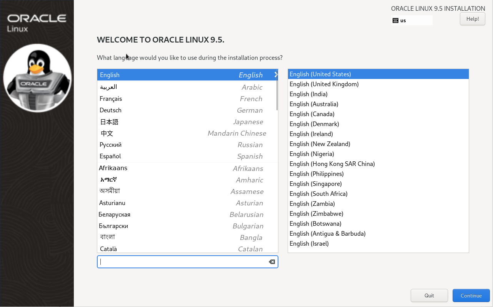

### Configure the Keyboard Layout

Select the appropriate keyboard layout. This installation includes German (Austria, no dead keys) and English (US).

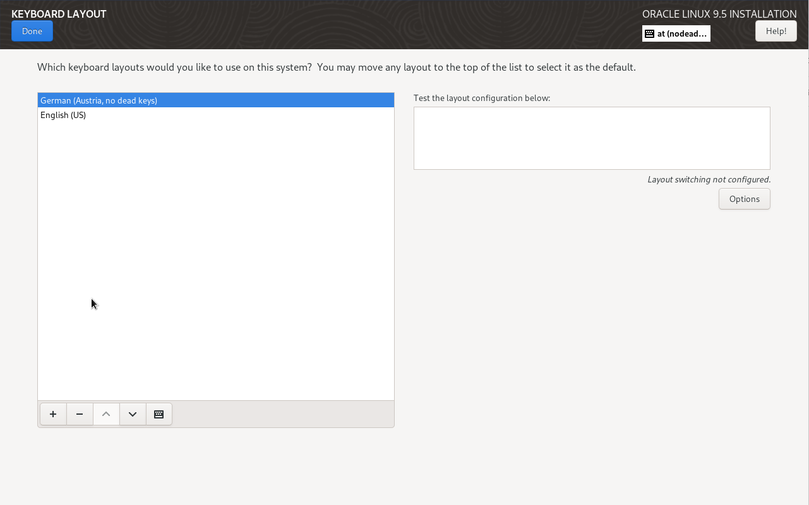

### Configure Time and Date

Set the appropriate time zone and enable network time synchronization where available. The example uses **Europe/Vienna**.


### Select Minimal Install

Under **Software Selection**, select **Minimal Install** without additional software groups. Oracle recommends a minimal base environment for the standalone OLVM Engine.

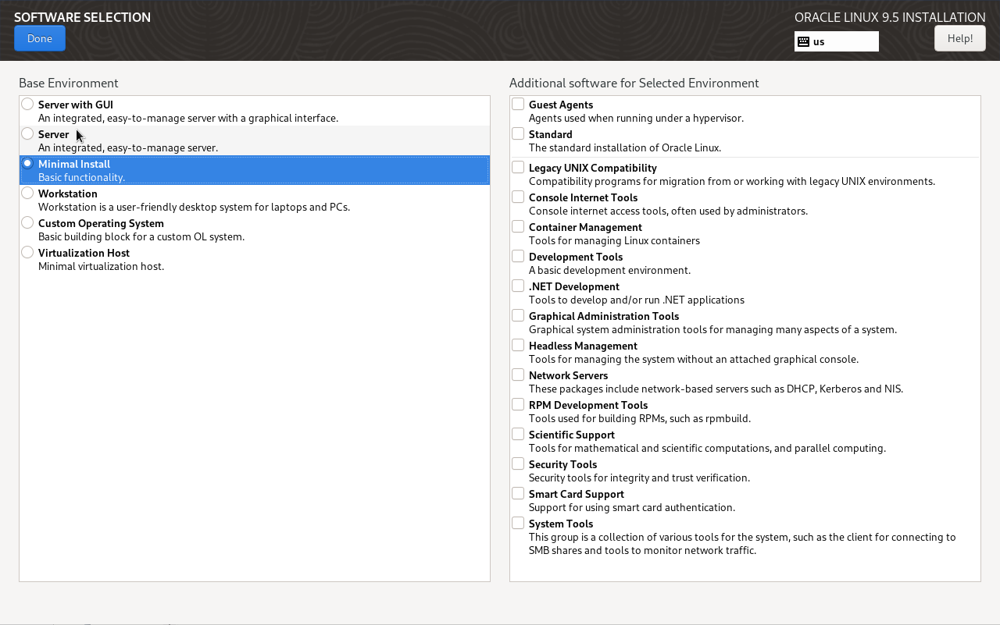

### Configure Installation Storage

Select the **100 GiB** installation disk and choose **Custom** storage configuration.

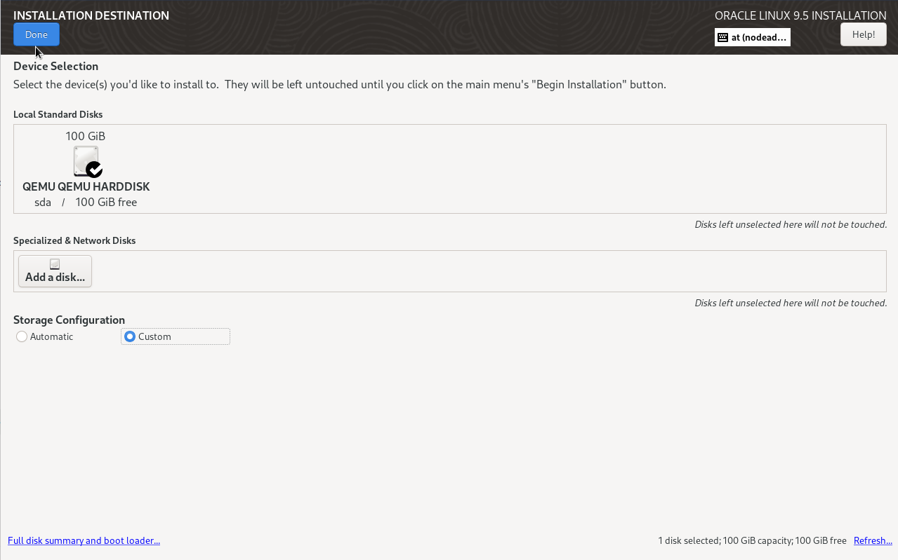

Use LVM for the operating system volumes and create the required EFI and boot partitions.

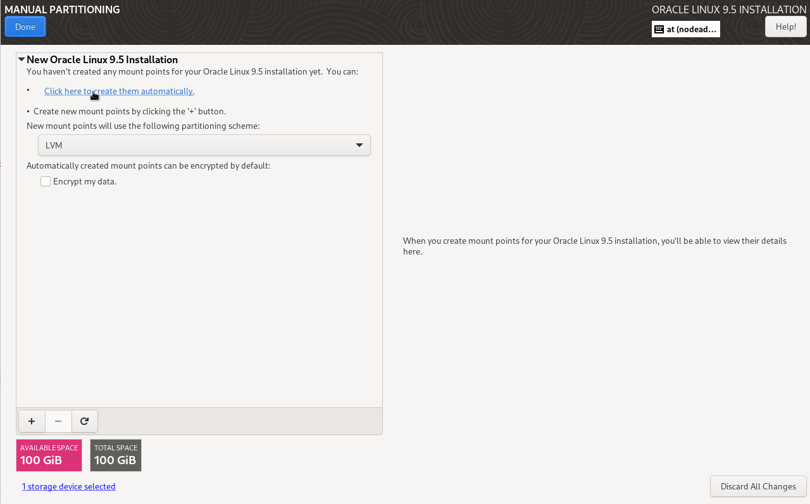

The screenshots show the following partitioning configuration:

| Mount point | Configuration | Size shown |
| --- | --- | --- |
| `/boot/efi` | EFI System Partition | 600 MiB |
| `/boot` | Standard XFS partition | 1 GiB |
| `/` | LVM, XFS | 50 GiB |
| `swap` | LVM swap volume | 7.67 GiB |
| `/home` | LVM, XFS | Adjusted during partitioning |


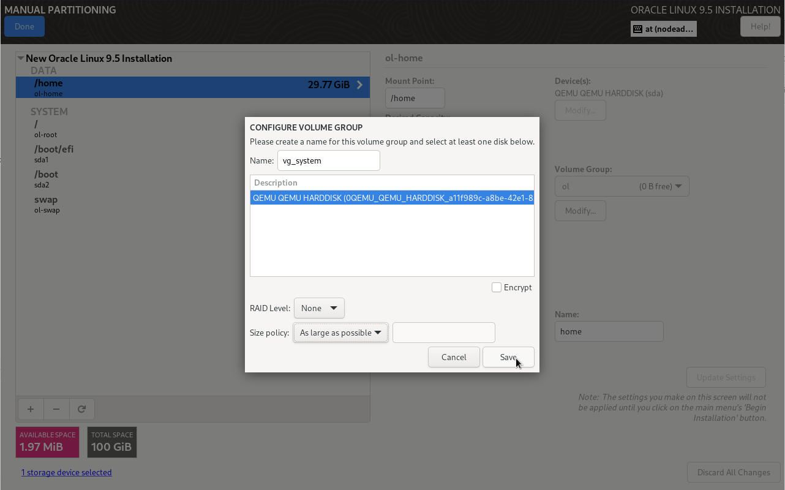

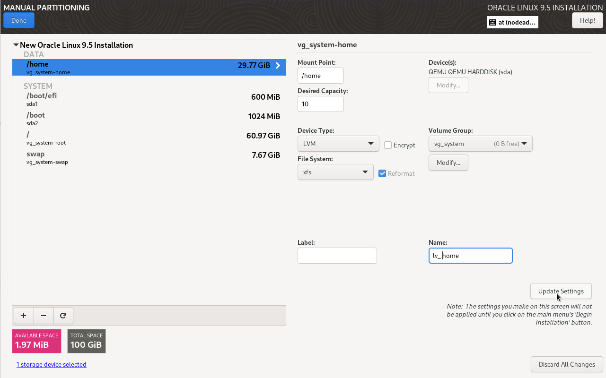

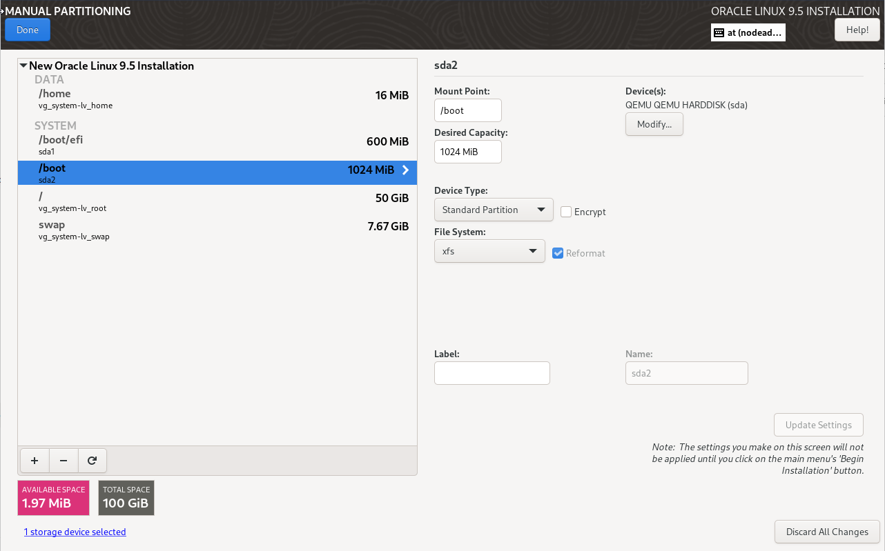

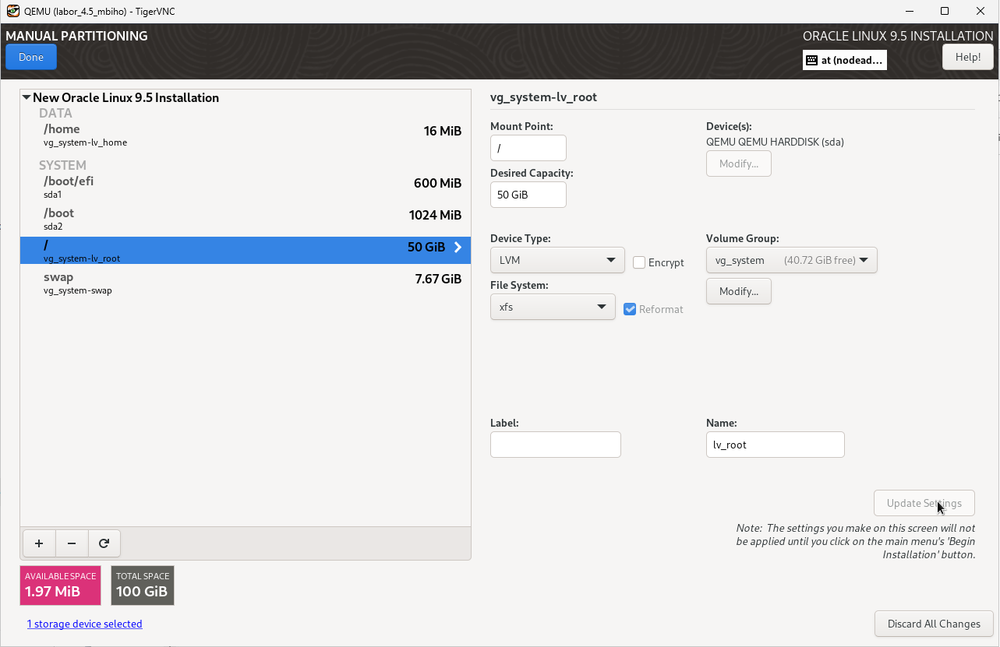

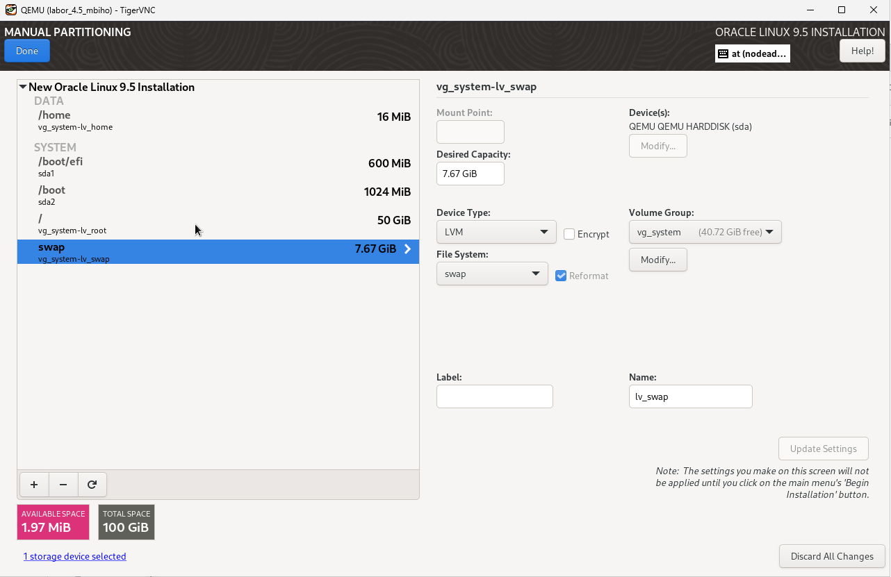


Review the proposed changes before accepting the disk layout.

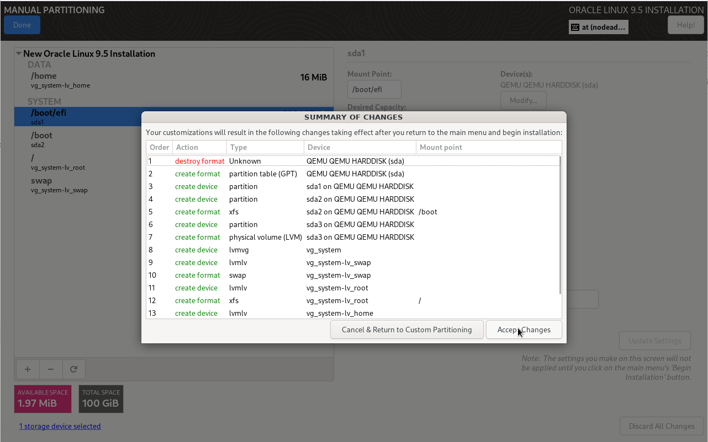

> **Important**
>
> The partitioning summary includes the creation of a new GPT partition table and formatting of the selected disk. Confirm that the correct installation disk is selected; existing data on that disk will be erased.

### Configure Network Settings

Configure a static IPv4 address on interface `enp1s0`.

| Setting | Value |
| --- | --- |
| Interface | `enp1s0` |
| IPv4 address | `10.50.71.54` |
| Netmask | `255.255.255.0` |
| Default gateway | `10.50.71.1` |
| DNS server | `10.50.71.2` |

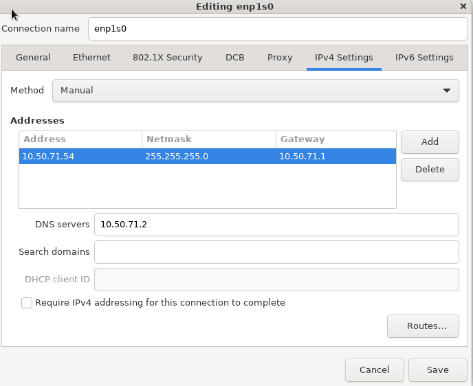

Enable the network interface and configure a fully qualified hostname that resolves correctly in DNS.

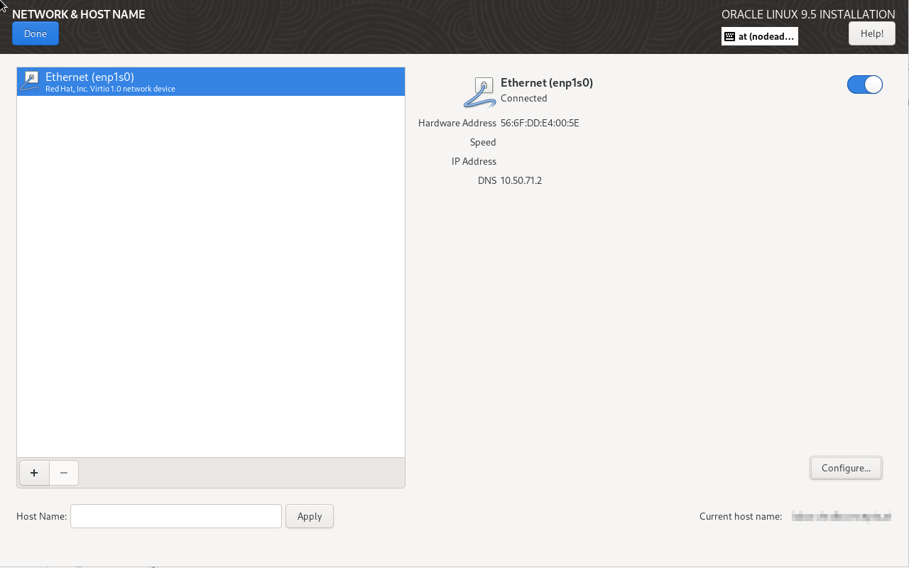

### Begin the Operating System Installation

Review the installation summary. Confirm **Minimal Install**, storage configuration, networking, and the root password, then select **Begin Installation**.

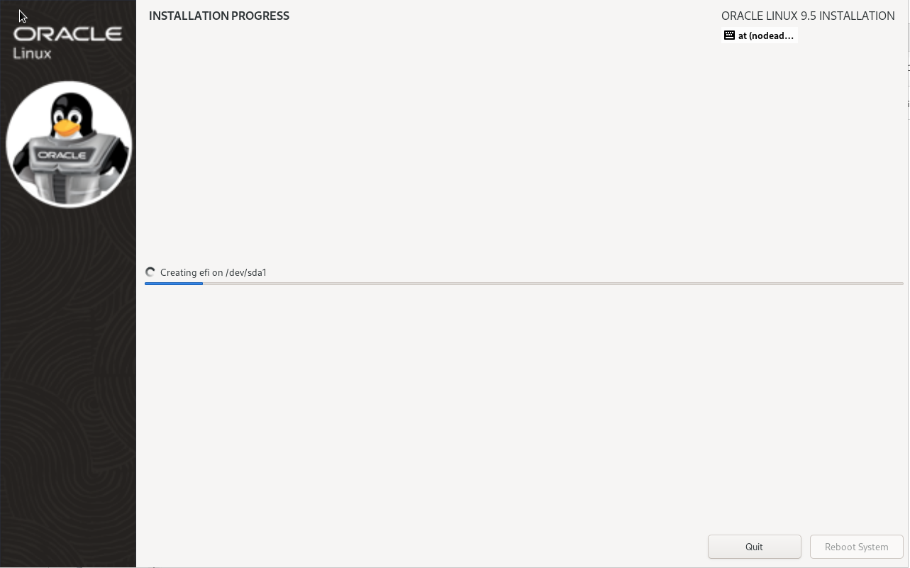

Wait for the installation to finish and reboot the server.

## Update Oracle Linux and Install UEK R8

After completing the Oracle Linux 9.5 installation, update the operating system to the latest available Oracle Linux 9 release and install Unbreakable Enterprise Kernel Release 8 (UEK R8).

### Update the Operating System

Verify the installed Oracle Linux release:

```bash
[root@labor ~]# cat /etc/oracle-release
```

Update all installed packages:

```bash
[root@labor ~]# dnf update -y
```

### Enable the UEK R8 Repository

Enable the Oracle Linux UEK R8 repository:

```bash
[root@labor ~]# dnf config-manager --enable ol9_UEKR8
```

Verify that the repository is enabled:

```bash
[root@labor ~]# dnf repolist | grep UEKR8
ol9_UEKR8    Oracle Linux 9 UEK Release 8 (x86_64)
```

### Install UEK R8

Install the latest available UEK R8 kernel and additional kernel modules:

```bash
[root@labor ~]# dnf install -y kernel-uek kernel-uek-modules-extra
```

In this environment, the following UEK R8 kernel was installed:

```text
kernel-uek-6.12.0-207.111.5.1.el9uek.x86_64
```

Update any remaining packages after enabling the UEK R8 repository:

```bash
[root@labor ~]# dnf update -y
```

Verify the installed UEK kernels:

```bash
[root@labor ~]# rpm -q kernel-uek
kernel-uek-5.15.0-302.167.6.el9uek.x86_64
kernel-uek-5.15.0-325.220.5.el9uek.x86_64
kernel-uek-6.12.0-207.111.5.1.el9uek.x86_64
```

### Reboot the Server

Reboot the operating system to activate the newly installed kernel:

```bash
[root@labor ~]# reboot
```

### Verify the Operating System and Kernel

After rebooting, verify the Oracle Linux release:

```bash
[root@labor ~]# cat /etc/oracle-release
Oracle Linux Server release 9.8

```

Verify the running kernel:

```bash
[root@labor ~]# uname -r
6.12.0-207.111.5.1.el9uek.x86_64
```

> **Important**
>
> Oracle Linux Virtualization Manager 4.5 requires a supported operating system and kernel combination. Verify that Oracle Linux 9.8 and UEK R8 are active before proceeding with the OLVM Engine installation.
>
> Installing UEK R8 does not automatically guarantee that the system has booted into it. Always verify the running kernel after reboot.

### Configure Hostname Resolution

Use a fully qualified domain name (FQDN) that resolves to the Engine's management IP address. This guide uses `labor.lab.example.com` as an example hostname.

```bash
[root@labor ~]# hostnamectl set-hostname labor.lab.example.com
```

Configure the appropriate forward and reverse DNS records. For an isolated lab without DNS records, add a local entry:

```bash
[root@labor ~]# printf '%s\n' '10.50.71.54 labor.lab.example.com labor' >> /etc/hosts
```

Verify the hostname and IPv4 resolution:

```bash
[root@labor ~]# hostname -f
labor.lab.example.com
[root@labor ~]# getent ahostsv4 labor.lab.example.com
```

> **Important**
>
> Continue with OLVM Engine installation only after confirming a supported Oracle Linux release, **UEK R8**, and correct hostname resolution. Do not run `engine-setup` until these requirements are satisfied.

## Next: Install the OLVM Engine

The next section configures the required Oracle Linux and OLVM 4.5 repositories, installs the Engine packages, runs `olvm-pre-check.py`, and completes the standalone Engine configuration with `engine-setup`. KVM host installation follows after the Engine is operational.

## Install Oracle Linux Virtualization Manager 4.5

After preparing Oracle Linux 9.8 and installing UEK R8, configure the OLVM repositories and install the Oracle Linux Virtualization Manager Engine.

The installation is performed on the standalone Engine server `labor.lab.example.com`.

### Install the OLVM Repository Configuration

Install the OLVM 4.5 repository release package:

```bash
[root@labor ~]# dnf install -y oracle-ovirt-release-45-el9
Last metadata expiration check: 0:09:35 ago on Mon 12 Oct 2026 12:50:36 PM CEST.
Dependencies resolved.
==============================================================================================================================================================================================================
 Package                                                       Architecture                          Version                                           Repository                                        Size
==============================================================================================================================================================================================================
Installing:
 oracle-ovirt-release-45-el9                                   x86_64                                1.0-10.el9                                        ol9_baseos_latest                                 26 k
Installing dependencies:
 python3-dnf-plugin-versionlock                                noarch                                4.3.0-26.0.1.el9                                  ol9_baseos_latest                                 34 k

Transaction Summary
==============================================================================================================================================================================================================
Install  2 Packages

Total download size: 60 k
Installed size: 78 k
Downloading Packages:
(1/2): python3-dnf-plugin-versionlock-4.3.0-26.0.1.el9.noarch.rpm                                                                                                             150 kB/s |  34 kB     00:00
(2/2): oracle-ovirt-release-45-el9-1.0-10.el9.x86_64.rpm                                                                                                                      113 kB/s |  26 kB     00:00
--------------------------------------------------------------------------------------------------------------------------------------------------------------------------------------------------------------
Total                                                                                                                                                                         258 kB/s |  60 kB     00:00
Running transaction check
Transaction check succeeded.
Running transaction test
Transaction test succeeded.
Running transaction
  Preparing        :                                                                                                                                                                                      1/1
  Installing       : python3-dnf-plugin-versionlock-4.3.0-26.0.1.el9.noarch                                                                                                                               1/2
  Running scriptlet: oracle-ovirt-release-45-el9-1.0-10.el9.x86_64                                                                                                                                        2/2
  Installing       : oracle-ovirt-release-45-el9-1.0-10.el9.x86_64                                                                                                                                        2/2
  Running scriptlet: oracle-ovirt-release-45-el9-1.0-10.el9.x86_64                                                                                                                                        2/2
Setting up modules. This can take a minute

  Verifying        : oracle-ovirt-release-45-el9-1.0-10.el9.x86_64                                                                                                                                        1/2
  Verifying        : python3-dnf-plugin-versionlock-4.3.0-26.0.1.el9.noarch                                                                                                                               2/2

Installed:
  oracle-ovirt-release-45-el9-1.0-10.el9.x86_64                                                     python3-dnf-plugin-versionlock-4.3.0-26.0.1.el9.noarch

Complete!
```

### Enable the Required Repositories

Enable the Oracle Linux and OLVM repositories:

```bash
[root@labor ~]# dnf config-manager --enable \
  ol9_baseos_latest \
  ol9_kvm_utils \
  ol9_addons \
  ol9_UEKR8 \
  ovirt-4.5 \
  ovirt-4.5-extra
```

The `ol9_appstream` repository must also be available and enabled.

Clean the DNF metadata and display the enabled repositories:

```bash
[root@labor ~]# dnf clean all
59 files removed
[root@labor ~]# dnf repolist
repo id                                                                               repo name
ol9_UEKR7                                                                             Oracle Linux 9 UEK Release 7 (x86_64)
ol9_UEKR8                                                                             Oracle Linux 9 UEK Release 8 (x86_64)
ol9_addons                                                                            Oracle Linux 9 Addons (x86_64)
ol9_appstream                                                                         Oracle Linux 9 Application Stream Packages (x86_64)
ol9_baseos_latest                                                                     Oracle Linux 9 BaseOS Latest (x86_64)
ol9_kvm_utils                                                                         Oracle Linux 9 KVM Utilities (x86_64)
ovirt-4.5                                                                             oVirt 4.5 Release (x86_64)
ovirt-4.5-extra                                                                       oVirt 4.5 Extra (x86_64)

```

Verify that all required repositories are listed before continuing.

### Install the OLVM Engine

Install the OLVM Engine packages:

```bash
[root@labor ~]# dnf install -y ovirt-engine
Oracle Linux 9 KVM Utilities (x86_64)                                                                                                                                         2.0 MB/s | 212 kB     00:00
Oracle Linux 9 BaseOS Latest (x86_64)                                                                                                                                          22 MB/s | 159 MB     00:07
Oracle Linux 9 Application Stream Packages (x86_64)                                                                                                                            22 MB/s | 111 MB     00:04
Oracle Linux 9 Addons (x86_64)                                                                                                                                                7.1 MB/s | 942 kB     00:00
oVirt 4.5 Release (x86_64)                                                                                                                                                    3.8 MB/s | 347 kB     00:00
oVirt 4.5 Extra (x86_64)                                                                                                                                                      5.0 MB/s | 454 kB     00:00
Oracle Linux 9 UEK Release 7 (x86_64)                                                                                                                                          27 MB/s | 131 MB     00:04
Oracle Linux 9 UEK Release 8 (x86_64)                                                                                                                                          26 MB/s |  62 MB     00:02
Dependencies resolved.
==============================================================================================================================================================================================================
 Package                                                               Architecture                Version                                                       Repository                              Size
==============================================================================================================================================================================================================
Installing:
 ovirt-engine                                                          noarch                      4.5.5-1.75.el9                                                ovirt-4.5                               14 M
Installing dependencies:
 ModemManager-glib                                                     x86_64                      1.20.2-1.el9                                                  ol9_baseos_latest                      334 k
 adobe-mappings-cmap                                                   noarch                      20171205-12.el9                                               ol9_appstream                          2.0 M
 adobe-mappings-cmap-deprecated                                        noarch                      20171205-12.el9                                               ol9_appstream                          129 k
 adobe-mappings-pdf                                                    noarch                      20180407-10.el9                                               ol9_appstream                          686 k
 adobe-source-code-pro-fonts                                           noarch                      2.030.1.050-12.el9.1                                          ol9_baseos_latest                      849 k
.....
.....
.....
 xdg-desktop-portal-1.12.6-1.el9.x86_64                                                                  xdg-desktop-portal-gtk-1.12.0-3.el9.x86_64
  xdg-utils-1.1.3-13.el9_6.noarch                                                                         xkeyboard-config-2.33-2.el9.noarch
  xml-common-0.6.3-58.el9.noarch                                                                          xmlrpc-client-3.1.3-1.el9.noarch
  xmlrpc-common-3.1.3-1.el9.noarch                                                                        xmlsec1-1.2.29-13.el9.x86_64
  xmlsec1-openssl-1.2.29-13.el9.x86_64                                                                    xorg-x11-fonts-ISO8859-1-100dpi-7.5-33.el9.noarch
  yajl-2.1.0-25.el9.x86_64

Complete!
```

Update any remaining packages:

```bash
[root@labor ~]# dnf update -y
```

Reboot the machine:

```bash
[root@labor ~]# reboot
```

### Run the OLVM Prerequisite Check

Before configuring the Engine, run the Oracle Linux Virtualization Manager prerequisite check:

```bash
[root@labor ~]# olvm-pre-check.py

-----------------------------------
    OLVM 4.5.5 PRE-CHECK SCRIPT
-----------------------------------

+++ Checking oracle-ovirt-release-45                     [PASS]
+++ Checking if Host is installed                        [WARN]

    The 'ovirt-engine' package is already installed.
    DO NOT configure this Server as a KVM Host.

+++ Checking if a Minimal Installation                   [PASS]
+++ Validating the 'Minimal Install' Group               [PASS]
+++ Checking enabled repositories                        [WARN]

    Extra repositories are enabled:
    ol9_UEKR7

    Please run the command:
    dnf config-manager --set-disabled ol9_UEKR7

+++ Running 'dnf makecache'                              [PASS]
+++ Dry run 'dnf update --assumeno'                      [PASS]
+++ Checking Linux Kernel                                [PASS]
+++ Checking kernel-uek-modules-extra                    [PASS]
+++ Checking Firewalld status                            [PASS]
+++ Checking SELinux status                              [PASS]
+++ Checking FIPS status                                 [PASS]
    FIPS is disabled.
+++ If installed, check ansible version                  [PASS]
+++ If installed, check qemu-kvm version                 [PASS]
+++ If installed, check libvirt version                  [PASS]
+++ Checking Hostname/FQDN                               [PASS]
```

The prerequisite check reports that the UEK R7 repository is still enabled. Since the Engine uses UEK R8, disable the UEK R7 repository:

```bash
[root@labor ~]# dnf config-manager --set-disabled ol9_UEKR7
```

Run the prerequisite check again:

```bash
[root@labor ~]# olvm-pre-check.py

-----------------------------------
    OLVM 4.5.5 PRE-CHECK SCRIPT
-----------------------------------

+++ Checking oracle-ovirt-release-45                     [PASS]
+++ Checking if Host is installed                        [WARN]

    The 'ovirt-engine' package is already installed.
    DO NOT configure this Server as a KVM Host.

+++ Checking if a Minimal Installation                   [PASS]
+++ Validating the 'Minimal Install' Group               [PASS]
+++ Checking enabled repositories                        [PASS]
+++ Running 'dnf makecache'                              [PASS]
+++ Dry run 'dnf update --assumeno'                      [PASS]
+++ Checking Linux Kernel                                [PASS]
+++ Checking kernel-uek-modules-extra                    [PASS]
+++ Checking Firewalld status                            [PASS]
+++ Checking SELinux status                              [PASS]
+++ Checking FIPS status                                 [PASS]
    FIPS is disabled.
+++ If installed, check ansible version                  [PASS]
+++ If installed, check qemu-kvm version                 [PASS]
+++ If installed, check libvirt version                  [PASS]
+++ Checking Hostname/FQDN                               [PASS]
```

All prerequisite checks now pass, except for the expected warning indicating that the `ovirt-engine` package is installed.

> **Note**
>
> The warning concerning the installed `ovirt-engine` package is expected for a standalone OLVM Engine. Do not configure this server as a KVM host.

> **Important**
>
> The Engine hostname must resolve to its management IP address. Ensure that `labor.lab.example.com` resolves to `10.50.71.54` and that the server can reach the required package repositories.

The system is now ready for the OLVM Engine configuration using `engine-setup`.

### Configure the OLVM Engine

Start the interactive Engine setup:

```bash
[root@labor ~]# engine-setup
[ INFO  ] Stage: Initializing
[ INFO  ] Stage: Environment setup
          Configuration files: /etc/ovirt-engine-setup.conf.d/10-packaging-jboss.conf, /etc/ovirt-engine-setup.conf.d/10-packaging.conf
          Log file: /var/log/ovirt-engine/setup/ovirt-engine-setup-20261012133512-1ohgsa.log
          Version: otopi-1.10.4 (otopi-1.10.4-1.el9)
[ INFO  ] Stage: Environment packages setup
[ INFO  ] Stage: Programs detection
[ INFO  ] Stage: Environment setup (late)
[ INFO  ] Stage: Environment customization

          --== PRODUCT OPTIONS ==--

          Configure Cinderlib integration (Currently in tech preview) (Yes, No) [No]:No
          Configure Engine on this host (Yes, No) [Yes]:Yes

          Configuring ovirt-provider-ovn also sets the Default cluster's default network provider to ovirt-provider-ovn.
          Non-Default clusters may be configured with an OVN after installation.
          Configure ovirt-provider-ovn (Yes, No) [Yes]:Yes
          Configure WebSocket Proxy on this host (Yes, No) [Yes]:Yes

          * Please note * : Data Warehouse is required for the engine.
          If you choose to not configure it on this host, you have to configure
          it on a remote host, and then configure the engine on this host so
          that it can access the database of the remote Data Warehouse host.
          Configure Data Warehouse on this host (Yes, No) [Yes]:Yes

          * Please note * : Keycloak is now deprecating AAA/JDBC authentication module.
          It is highly recommended to install Keycloak based authentication.
          Configure Keycloak on this host (Yes, No) [Yes]:Yes
          Configure VM Console Proxy on this host (Yes, No) [Yes]:Yes
          Configure Grafana on this host (Yes, No) [Yes]:Yes

          --== PACKAGES ==--

[ INFO  ] Checking for product updates...
[ INFO  ] No product updates found

          --== NETWORK CONFIGURATION ==--

          Host fully qualified DNS name of this server [labor.lab.example.com]:

          Setup can automatically configure the firewall on this system.
          Note: automatic configuration of the firewall may overwrite current settings.
          Do you want Setup to configure the firewall? (Yes, No) [Yes]:Yes
[ INFO  ] firewalld will be configured as firewall manager.

          --== DATABASE CONFIGURATION ==--

          Where is the DWH database located? (Local, Remote) [Local]:Local

          Setup can configure the local postgresql server automatically for the DWH to run. This may conflict with existing applications.
          Would you like Setup to automatically configure postgresql and create DWH database, or prefer to perform that manually? (Automatic, Manual) [Automatic]:Automatic
          Where is the Keycloak database located? (Local, Remote) [Local]:Local

          Setup can configure the local postgresql server automatically for the Keycloak to run. This may conflict with existing applications.
          Would you like Setup to automatically configure postgresql and create Keycloak database, or prefer to perform that manually? (Automatic, Manual) [Automatic]:Automatic
          Where is the Engine database located? (Local, Remote) [Local]:Local

          Setup can configure the local postgresql server automatically for the engine to run. This may conflict with existing applications.
          Would you like Setup to automatically configure postgresql and create Engine database, or prefer to perform that manually? (Automatic, Manual) [Automatic]:Automatic

          --== OVIRT ENGINE CONFIGURATION ==--

          Engine admin password:
          Confirm engine admin password:
          Application mode (Virt, Gluster, Both) [Both]:Both
          Use Engine admin password as initial keycloak admin password (Yes, No) [Yes]:Yes

          --== STORAGE CONFIGURATION ==--

          Default SAN wipe after delete (Yes, No) [No]:No

          --== PKI CONFIGURATION ==--

          Organization name for certificate [lab.example.com]:

          --== APACHE CONFIGURATION ==--

          Setup can configure the default page of the web server to present the application home page. This may conflict with existing applications.
          Do you wish to set the application as the default page of the web server? (Yes, No) [Yes]:Yes

          Setup can configure apache to use SSL using a certificate issued from the internal CA.
          Do you wish Setup to configure that, or prefer to perform that manually? (Automatic, Manual) [Automatic]:Automatic

          --== SYSTEM CONFIGURATION ==--


          --== MISC CONFIGURATION ==--

          Please choose Data Warehouse sampling scale:
          (1) Basic
          (2) Full
          (1, 2)[1]:1
          Use Engine admin password as initial Grafana admin password (Yes, No) [Yes]:yes

          --== END OF CONFIGURATION ==--

[ INFO  ] Stage: Setup validation
[WARNING] Less than 16384MB of memory is available

          --== CONFIGURATION PREVIEW ==--

          Application mode                        : both
          Default SAN wipe after delete           : False
          Host FQDN                               : labor.lab.example.com
          Firewall manager                        : firewalld
          Update Firewall                         : True
          Set up Cinderlib integration            : False
          Configure local Engine database         : True
          Set application as default page         : True
          Configure Apache SSL                    : True
          Keycloak installation                   : True
          Engine database host                    : localhost
          Engine database port                    : 5432
          Engine database secured connection      : False
          Engine database host name validation    : False
          Engine database name                    : engine
          Engine database user name               : engine
          Engine installation                     : True
          PKI organization                        : lab.example.com
          Set up ovirt-provider-ovn               : True
          DWH installation                        : True
          DWH database host                       : localhost
          DWH database port                       : 5432
          DWH database secured connection         : False
          DWH database host name validation       : False
          DWH database name                       : ovirt_engine_history
          Configure local DWH database            : True
          Grafana integration                     : True
          Grafana database user name              : ovirt_engine_history_grafana
          Keycloak database host                  : localhost
          Keycloak database port                  : 5432
          Keycloak database secured connection    : False
          Keycloak database host name validation  : False
          Keycloak database name                  : ovirt_engine_keycloak
          Keycloak database user name             : ovirt_engine_keycloak
          Configure local Keycloak database       : True
          Configure VMConsole Proxy               : True
          Configure WebSocket Proxy               : True

          Please confirm installation settings (OK, Cancel) [OK]:OK
[ INFO  ] Stage: Transaction setup
[ INFO  ] Stopping engine service
[ INFO  ] Stopping ovirt-fence-kdump-listener service
[ INFO  ] Stopping dwh service
[ INFO  ] Stopping vmconsole-proxy service
[ INFO  ] Stopping websocket-proxy service
[ INFO  ] Stage: Misc configuration (early)
[ INFO  ] Stage: Package installation
[ INFO  ] Stage: Misc configuration
[ INFO  ] Upgrading CA
[ INFO  ] Initializing PostgreSQL
[ INFO  ] Creating PostgreSQL 'engine' database
[ INFO  ] Configuring PostgreSQL
[ INFO  ] Creating PostgreSQL 'ovirt_engine_history' database
[ INFO  ] Configuring PostgreSQL
[ INFO  ] Creating PostgreSQL 'ovirt_engine_keycloak' database
[ INFO  ] Configuring PostgreSQL
[ INFO  ] Creating CA: /etc/pki/ovirt-engine/ca.pem
[ INFO  ] Creating CA: /etc/pki/ovirt-engine/qemu-ca.pem
[ INFO  ] Creating a user for Grafana
[ INFO  ] Allowing ovirt_engine_history_grafana to read data on ovirt_engine_history
[ INFO  ] Setting up ovirt-vmconsole proxy helper PKI artifacts
[ INFO  ] Setting up ovirt-vmconsole SSH PKI artifacts
[ INFO  ] Configuring WebSocket Proxy
[ INFO  ] Creating/refreshing Engine database schema
[ INFO  ] Creating/refreshing DWH database schema
[ INFO  ] Updating OVN SSL configuration
[ INFO  ] Updating OVN timeout configuration
[ INFO  ] Creating/refreshing Engine 'internal' domain database schema
[ INFO  ] Creating default mac pool range
[ INFO  ] Adding default OVN provider to database
[ INFO  ] Adding OVN provider secret to database
[ INFO  ] Setting a password for internal user admin
[ INFO  ] Creating initial Keycloak admin user
[ INFO  ] Generating post install configuration file '/etc/ovirt-engine-setup.conf.d/20-setup-ovirt-post.conf'
[ INFO  ] Stage: Transaction commit
[ INFO  ] Stage: Closing up

          --== SUMMARY ==--

[ INFO  ] No need to restart fapolicyd because it is not running.
[ INFO  ] Starting dwh service
[ INFO  ] Starting Grafana service
[ INFO  ] Restarting ovirt-vmconsole proxy service
          To login to oVirt using Keycloak SSO, enter 'admin@ovirt' as username and the password provided during Setup
          To login to Keycloak Administration Console enter 'admin' as username and the password provided during Setup
          Web access for Keycloak Administration Console is enabled at:
              https://labor.lab.example.com/ovirt-engine-auth/admin
          Web access is enabled at:
              http://labor.lab.example.com:80/ovirt-engine
              https://labor.lab.example.com:443/ovirt-engine
          Internal CA fingerprint: SHA256: A8:39:0E:C1:F4:EF:72:CB:0E:CF:E4:7D:4E:7C:71:6A:C7:30:A6:82:F4:19:D8:16:30:16:1A:5F:8B:89:71:49
          SSH fingerprint: SHA256:sUnUN7C0jPWwHvCODTtgs5ERT3RFAAQsoqV/lFxDJ10
[ INFO  ] Starting engine service
[WARNING] Less than 16384MB of memory is available
          Web access for grafana is enabled at:
              https://labor.lab.example.com/ovirt-engine-grafana/
          Please run the following command on the engine machine labor.lab.example.com, for SSO to work:
          systemctl restart ovirt-engine

          --== END OF SUMMARY ==--

[ INFO  ] Restarting httpd
[ INFO  ] Start with setting up Keycloak for Ovirt Engine
[ INFO  ] Done with setting up Keycloak for Ovirt Engine
[ INFO  ] Stage: Clean up
          Log file is located at /var/log/ovirt-engine/setup/ovirt-engine-setup-20261012133512-1ohgsa.log
[ INFO  ] Generating answer file '/var/lib/ovirt-engine/setup/answers/20261012134159-setup.conf'
[ INFO  ] Stage: Pre-termination
[ INFO  ] Stage: Termination
[ INFO  ] Execution of setup completed successfully
```

The setup utility configures the OLVM Engine, its database, certificates, authentication services, and web interface.

Follow the interactive prompts and review the proposed configuration before confirming installation.

For a new installation, use the recommended Keycloak authentication configuration unless the environment requires another supported authentication arrangement.

> **Note**
>
> The Engine setup process may take several minutes. Do not interrupt the configuration while services, certificates, and database components are being initialized.

### Access the OLVM Administration Portal

After a successful Engine setup, open the administration portal using the Engine FQDN:

```text
https://labor.lab.example.com/ovirt-engine
```

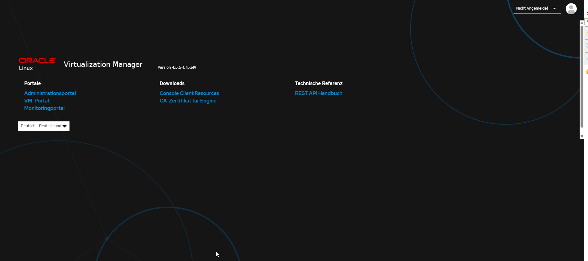

Sign in using the administrator credentials configured during `engine-setup`.

> **Important**
>
> The standalone OLVM Engine must be installed and operational before adding Oracle Linux KVM hosts. KVM host installation and registration are covered in the next section.

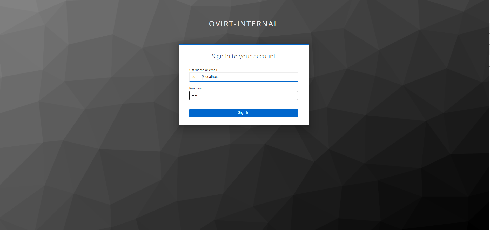
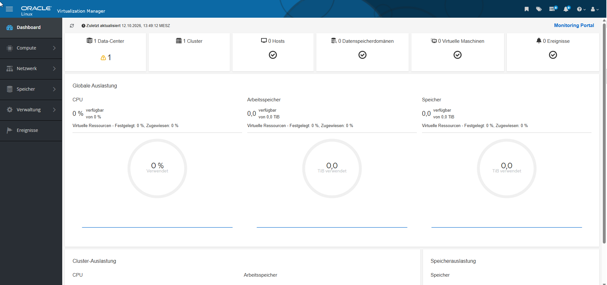

## Verify the OLVM Engine Installation

After completing `engine-setup`, verify that the OLVM Engine services, network configuration, firewall, and Administration Portal are functioning correctly.

### Verify the OLVM Engine Service

Check the Engine service:

```bash
[root@labor ~]# systemctl status ovirt-engine
● ovirt-engine.service - oVirt Engine
     Loaded: loaded (/usr/lib/systemd/system/ovirt-engine.service; enabled; preset: disabled)
     Active: active (running) since Mon 2026-10-12 13:40:18 CEST; 30min ago
   Main PID: 21458 (ovirt-engine.py)
      Tasks: 190 (limit: 45913)
     Memory: 1.8G (peak: 1.8G)
        CPU: 1min 36.582s
     CGroup: /system.slice/ovirt-engine.service
             ├─21458 /usr/bin/python3 /usr/share/ovirt-engine/services/ovirt-engine/ovirt-engine.py --redirect-output --systemd=notify start
             └─21748 ovirt-engine --add-modules java.se --add-modules java.naming --add-modules jdk.naming.dns --add-exports java.naming/com.sun.jndi.ldap=ALL-UNNAMED --add-exports jdk.naming.dns/com.sun.j>

Oct 12 13:40:17 labor.lab.example.com systemd[1]: Starting oVirt Engine...
Oct 12 13:40:18 labor.lab.example.com systemd[1]: Started oVirt Engine.
Oct 12 13:40:18 labor.lab.example.com ovirt-engine.py[21458]: 2026-10-12 13:40:18,176+0200 ovirt-engine: INFO _detectJBossVersion:183 Detecting JBoss version. Running: /usr/lib/jvm/jre-21/bin/java ['ovir>
Oct 12 13:40:19 labor.lab.example.com ovirt-engine.py[21458]: 2026-10-12 13:40:19,790+0200 ovirt-engine: INFO _detectJBossVersion:202 Return code: 0,  | stdout: '['WildFly Full 24.0.1.Final (WildFly Core>
```

The service should report `active (running)`.

### Verify the Firewall Configuration

Check the active firewall zone:

```bash
[root@labor ~]# firewall-cmd --get-active-zones
public
  interfaces: enp1s0
```

Display the active firewall configuration:

```bash
[root@labor ~]# firewall-cmd --list-all
public (active)
  target: default
  icmp-block-inversion: no
  interfaces: enp1s0
  sources:
  services: cockpit dhcpv6-client ovirt-fence-kdump-listener ovirt-http ovirt-https ovirt-imageio-proxy ovirt-postgres ovirt-provider-ovn ovirt-vmconsole-proxy ovirt-websocket-proxy ovn-central-firewall-service ssh
  ports: 9986/tcp
  protocols:
  forward: yes
  masquerade: no
  forward-ports:
  source-ports:
  icmp-blocks:
  rich rules:
```

The OLVM firewall services are enabled in the active `public` zone.

Verify that the configuration is persistent:

```bash

[root@labor ~]# firewall-cmd --permanent --list-all
public
  target: default
  icmp-block-inversion: no
  interfaces:
  sources:
  services: cockpit dhcpv6-client ovirt-fence-kdump-listener ovirt-http ovirt-https ovirt-imageio-proxy ovirt-postgres ovirt-provider-ovn ovirt-vmconsole-proxy ovirt-websocket-proxy ovn-central-firewall-service ssh
  ports: 9986/tcp
  protocols:
  forward: yes
  masquerade: no
  forward-ports:
  source-ports:
  icmp-blocks:
  rich rules:
```

> **Note**
>
> OLVM uses predefined firewalld services such as `ovirt-http` and `ovirt-https`. These services configure the corresponding ports without requiring separate manual port rules.

### Verify SELinux

Check the SELinux status:

```bash
[root@labor ~]# getenforce
Enforcing
```

> **Important**
>
> Keep SELinux enabled in enforcing mode. Do not disable SELinux to resolve installation or connectivity problems without first investigating the underlying issue.

### Verify Time Synchronization

Check the system time and NTP synchronization:

```bash
[root@labor ~]# timedatectl
               Local time: Mon 2026-10-12 14:07:45 CEST
           Universal time: Mon 2026-10-12 12:07:45 UTC
                 RTC time: Mon 2026-10-12 12:07:45
                Time zone: Europe/Vienna (CEST, +0200)
System clock synchronized: yes
              NTP service: active
          RTC in local TZ: no

```

Verify the chrony service:

```bash

[root@labor ~]# systemctl status chronyd
● chronyd.service - NTP client/server
     Loaded: loaded (/usr/lib/systemd/system/chronyd.service; enabled; preset: enabled)
     Active: active (running) since Mon 2026-10-12 13:08:57 CEST; 58min ago
       Docs: man:chronyd(8)
             man:chrony.conf(5)
   Main PID: 951 (chronyd)
      Tasks: 1 (limit: 45913)
     Memory: 1.4M (peak: 2.1M)
        CPU: 72ms
     CGroup: /system.slice/chronyd.service
             └─951 /usr/sbin/chronyd -F 2

Oct 12 13:08:57 labor.lab.example.com systemd[1]: Starting NTP client/server...
Oct 12 13:08:57 labor.lab.example.com chronyd[951]: chronyd version 4.8 starting (+CMDMON +REFCLOCK +RTC +PRIVDROP +SCFILTER +SIGND +NTS +SECHASH +IPV6 +DEBUG)
Oct 12 13:08:57 labor.lab.example.com chronyd[951]: Loaded 0 symmetric keys
Oct 12 13:08:57 labor.lab.example.com chronyd[951]: Using right/UTC timezone to obtain leap second data
Oct 12 13:08:57 labor.lab.example.com chronyd[951]: Frequency -91.254 +/- 0.787 ppm read from /var/lib/chrony/drift
Oct 12 13:08:57 labor.lab.example.com systemd[1]: Started NTP client/server.
Oct 12 13:08:57 labor.lab.example.com chronyd[951]: Loaded seccomp filter (level 2)
Oct 12 13:09:02 labor.lab.example.com chronyd[951]: Selected source 10.51.160.132 (vsvdc04.lab.example.com)
Oct 12 13:09:02 labor.lab.example.com chronyd[951]: System clock TAI offset set to 37 seconds
```

Check synchronization sources:

```bash

[root@labor ~]# chronyc sources -v

  .-- Source mode  '^' = server, '=' = peer, '#' = local clock.
 / .- Source state '*' = current best, '+' = combined, '-' = not combined,
| /             'x' = may be in error, '~' = too variable, '?' = unusable.
||                                                 .- xxxx [ yyyy ] +/- zzzz
||      Reachability register (octal) -.           |  xxxx = adjusted offset,
||      Log2(Polling interval) --.      |          |  yyyy = measured offset,
||                                \     |          |  zzzz = estimated error.
||                                 |    |           \
MS Name/IP address         Stratum Poll Reach LastRx Last sample
===============================================================================
^+ vsvdc03.lab.example.com     5   6   377     5    -13us[  -13us] +/-   71ms
^* vsvdc04.lab.example.com     4   6   377     6   +227us[ +101us] +/-   45ms

```

Correct time synchronization is important for certificates, authentication, and communication between the Engine and KVM hosts.

## Configure the OLVM Data Center and Cluster

After successfully installing and verifying the OLVM Engine, create a data center and cluster through the Administration Portal.

A **data center** provides a logical container for clusters, storage domains, and virtual networks. A **cluster** groups KVM hosts with compatible CPU and virtualization settings.

### Step 1: Create the Data Center

Log in to the OLVM Administration Portal and navigate to **Compute → Data Centers**.

Click **New** and configure the data center with the following settings:

| Parameter | Value |
| --- | --- |
| Name | `DC-LAB` |
| Description | `OLVM Test` |
| Storage Type | `Shared` |
| Compatibility Version | `4.7` |
| Quota Mode | `Disabled` |

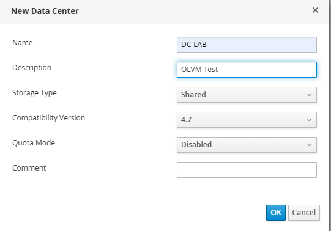

Click **OK** to create the data center.

The **Data Center - Guide Me** dialog appears and lists the remaining configuration tasks, including the cluster, hosts, and storage domains.

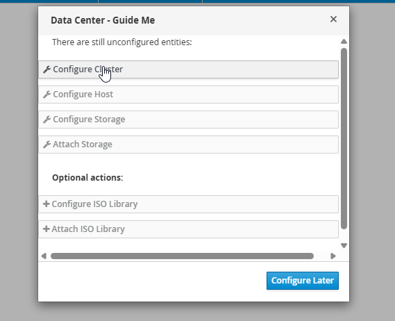

Click **Configure Later** to continue with the cluster configuration manually.

> **Note**
>
> The data center may initially display a `Down` or `Uninitialized` status because no operational KVM hosts or active storage domains are available. This is expected at this stage.

### Step 2: Create the Cluster

Navigate to **Compute → Clusters** and click **New**.

Configure the cluster with the following settings:

| Parameter | Value |
| --- | --- |
| Data Center | `DC-LAB` |
| Name | `CL-KVM` |
| Management Network | `ovirtmgmt` |
| CPU Architecture | `x86_64` |
| CPU Type | `Intel Nehalem Family` |
| Chipset/Firmware Type | `Auto Detect` |
| FIPS Mode | `Auto Detect` |
| Compatibility Version | `4.7` |
| Switch Type | `Linux Bridge` |

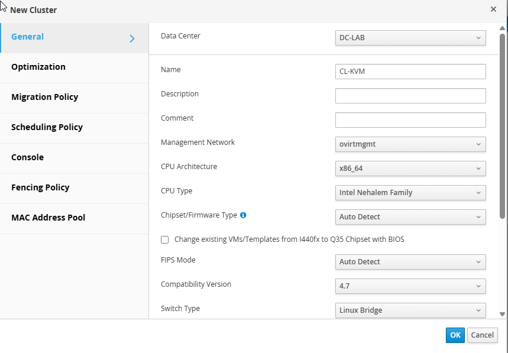

Review the remaining cluster settings and retain the defaults where appropriate.

> **Important**
>
> The cluster CPU type must be compatible with the processors of all KVM hosts that will join the cluster. The `Intel Nehalem Family` setting shown here must be verified against the actual KVM host hardware before host registration.

Click **OK** to create the cluster.

The **Cluster - Guide Me** dialog confirms that the cluster has been created and offers the option to configure a host.

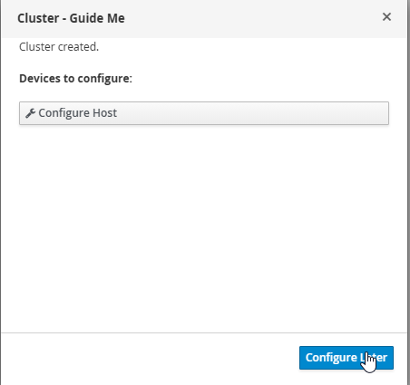

Click **Configure Later**. The KVM host installation and registration will be covered in the next section.

### Verify the Data Center and Cluster

Navigate to **Compute → Data Centers** and confirm that `DC-LAB` exists.

Navigate to **Compute → Clusters** and confirm that `CL-KVM` is assigned to `DC-LAB`.

At this stage, both objects have been created, but the environment is not yet operational because no KVM hosts or storage domains have been configured.

> **Note**
>
> The data center and cluster configuration is complete. Their operational status will change as the required KVM hosts and storage resources are added.

### Next: Install and Register the First KVM Host

The next step is to install Oracle Linux on a separate KVM server, configure its management network and virtualization prerequisites, and register it with the `CL-KVM` cluster.

After the first KVM host is operational, configure the shared iSCSI storage domain on the ZFS Storage Appliance.

## Oracle Linux KVM Host Prerequisites

Before installing and registering Oracle Linux KVM hosts with Oracle Linux Virtualization Manager 4.5, verify that the hardware, operating system, networking, and storage requirements are satisfied.

The KVM hosts must be installed on separate servers and must not share the standalone OLVM Engine operating system.

### Hardware and Operating System Requirements

The following requirements are based on the Oracle Linux Virtualization Manager 4.5 *Architecture and Planning Guide*.

| Component | Minimum Requirement | Recommendation |
| --- | --- | --- |
| Deployment | On-premises host | Dedicated physical server |
| Operating System | Oracle Linux 9.6 or later (9.x), or Oracle Linux 8.8 or later (8.x) | Oracle Linux 9.8 |
| Installation Type | Minimal Install | No additional software groups |
| Kernel (Oracle Linux 9) | UEK R8 | Latest supported UEK R8 kernel |
| Processor | 64-bit dual-core CPU | Multiple CPUs |
| Hardware Virtualization | Intel VT-x or AMD-V, with NX support | Enabled in BIOS/UEFI |
| Memory | 2 GB RAM | Sized according to virtual machine workloads |
| Network | One NIC with at least 1 Gbps bandwidth | Two or more NICs |
| Local Disk | 60 GB | Additional capacity as required |
| Cluster Compatibility | 4.7 for Oracle Linux 9 KVM hosts | 4.7 |
| OLVM Engine Version | `ovirt-engine-4.5.5-1.65` or later | Latest supported OLVM 4.5 release |

> **Important**
>
> Oracle Linux 9 KVM hosts require **UEK R8**, cluster compatibility version **4.7**, and an OLVM Engine running `ovirt-engine-4.5.5-1.65` or later.
>
> Use **Minimal Install** when installing Oracle Linux. Do not install additional packages before preparing and registering the host, unless explicitly required by Oracle's installation procedure.

### Local Disk Requirements

Oracle specifies at least **60 GB** of locally accessible, writable disk space for each KVM host.

| Mount Point | Minimum Size |
| --- | --- |
| `/` | 30 GB |
| `/boot` | 1 GB |
| `/var` | 29 GB |
| **Total** | **60 GB** |

> **Note**
>
> The local disk is used for the KVM host operating system and management components. Virtual machine disks will be stored separately on the shared iSCSI storage domain.

### CPU Virtualization Requirements

The physical processors must support Intel VT-x or AMD-V hardware virtualization extensions and the NX (No Execute) feature.

Hardware virtualization must be enabled in the system BIOS or UEFI.

After installing Oracle Linux, verify CPU virtualization support:

```bash
[root@psvtnubecu1 ~]# lscpu | grep -E 'Virtualization|Architecture'
Architecture:                       x86_64
Virtualization:                     VT-x
```

Verify that the processor exposes Intel `vmx` or AMD `svm` extensions:

```bash
[root@psvtnubecu1 ~]# grep -E -m 1 'vmx|svm' /proc/cpuinfo
flags           : fpu vme de pse tsc msr pae mce cx8 apic sep mtrr pge mca cmov pat pse36 clflush dts acpi mmx fxsr sse sse2 ss ht tm pbe syscall nx pdpe1gb rdtscp lm constant_tsc arch_perfmon pebs bts rep_good nopl xtopology nonstop_tsc cpuid aperfmperf pni pclmulqdq dtes64 monitor ds_cpl vmx smx est tm2 ssse3 sdbg fma cx16 xtpr pdcm pcid dca sse4_1 sse4_2 x2apic movbe popcnt tsc_deadline_timer aes xsave avx f16c rdrand lahf_lm abm cpuid_fault epb invpcid_single pti intel_ppin ssbd ibrs ibpb stibp tpr_shadow flexpriority ept vpid ept_ad fsgsbase tsc_adjust bmi1 avx2 smep bmi2 erms invpcid cqm xsaveopt cqm_llc cqm_occup_llc dtherm ida arat pln pts vnmi md_clear flush_l1d
```

> **Important**
>
> The CPU type configured in the OLVM cluster must be supported by all hosts assigned to that cluster. Verify that the selected `Intel Nehalem Family` CPU type is compatible with the planned KVM hardware.

### Network Requirements

Each KVM host requires reliable management connectivity to the OLVM Engine.

At least one network interface with 1 Gbps bandwidth is required. Oracle recommends two or more network interfaces to separate network-intensive workloads, such as virtual machine migration.

The following example network design is used for this environment:

| Component | Configuration |
| --- | --- |
| OLVM Engine FQDN | `labor.lab.example.com` |
| OLVM Engine IP | `10.50.71.54` |
| Management Network | `ovirtmgmt` |
| KVM Host FQDN | To be assigned |
| KVM Host Management IP | To be assigned |
| Storage Appliance | `100.66.71.25` |
| Storage Protocol | iSCSI |
| Storage Port | TCP 3260 |

Before registering the host, verify that its FQDN resolves correctly and that it can communicate with the OLVM Engine.

```bash
[root@psvtnubecu1 ~]# hostname -f
psvtnubecu1.nubecula
[root@psvtnubecu1 ~]# getent ahostsv4 labor.lab.example.com
10.50.71.54     STREAM labor.lab.example.com
10.50.71.54     DGRAM
10.50.71.54     RAW
```

Verify network connectivity:

```bash
[root@psvtnubecu1 ~]# ping -c 4 10.50.71.54
PING 10.50.71.54 (10.50.71.54) 56(84) bytes of data.
64 bytes from 10.50.71.54: icmp_seq=1 ttl=64 time=0.516 ms
64 bytes from 10.50.71.54: icmp_seq=2 ttl=64 time=0.331 ms
64 bytes from 10.50.71.54: icmp_seq=3 ttl=64 time=0.316 ms
64 bytes from 10.50.71.54: icmp_seq=4 ttl=64 time=0.306 ms

--- 10.50.71.54 ping statistics ---
4 packets transmitted, 4 received, 0% packet loss, time 3081ms
rtt min/avg/max/mdev = 0.306/0.367/0.516/0.086 ms
```

> **Note**
>
> Configure forward and reverse DNS resolution and synchronize system time across the OLVM Engine and all KVM hosts. Where possible, use separate interfaces or VLANs for management, storage, and virtual machine migration traffic.

### Firewall and Port Requirements

The required firewall ports must be permitted between the OLVM Engine, KVM hosts, administration clients, and storage systems.

Oracle Linux Virtualization Manager can automatically configure the KVM host firewall when the host is registered through the Administration Portal.

| Port | Protocol | Source | Destination | Purpose |
| --- | --- | --- | --- | --- |
| 22 | TCP | OLVM Engine | KVM Host | SSH administration and host deployment |
| 2223 | TCP | OLVM Engine | KVM Host | Virtual machine serial console |
| 5900–6923 | TCP | Console clients | KVM Host | Virtual machine console connections |
| 6081 | UDP | KVM Host | KVM Host | OVN networking, when enabled |
| 16514 | TCP | KVM Host | KVM Host | Virtual machine migration using libvirt |
| 49152–49216 | TCP | KVM Host | KVM Host | Migration and fencing using VDSM |
| 54321 | TCP | OLVM Engine / KVM Hosts | KVM Host | VDSM management communication |
| 54322 | TCP | OLVM Engine / Image I/O Proxy | KVM Host | Virtual disk image transfer |

Additional optional ports may be required for NFS, SNMP, or CIMOM, depending on the environment.

> **Important**
>
> During KVM host registration, OLVM can replace the existing host firewall configuration with its required rules. Leave **Automatically configure host firewall** enabled unless firewall rules are managed externally.

### Shared Storage Requirements

The environment uses a ZFS Storage Appliance providing shared block storage through iSCSI.

| Component | Configuration |
| --- | --- |
| Storage System | ZFS Storage Appliance |
| IP Address | `100.66.71.25` |
| Protocol | iSCSI |
| TCP Port | `3260` |
| Data Storage Domain | `default_domain` |
| LUN Capacity | 1 TB |
| LUN GUID | `600144F0EB1FAD90000063E0F0B60007` |

Before configuring the storage domain, ensure that each KVM host can reach the storage appliance and that its iSCSI initiator is authorized to access the LUN.

### Software and Configuration Restrictions

Oracle recommends keeping KVM hosts dedicated to virtualization workloads.

Do not install third-party watchdog services, as they may interfere with the watchdog functionality provided by VDSM.

Avoid installing unrelated applications or unsupported packages that could conflict with the KVM hypervisor, QEMU, libvirt, or OLVM host management components.

> **Note**
>
> Oracle Linux 9 KVM hosts do not support GlusterFS or hyperconverged configurations in OLVM 4.5.

### Install and Prepare the Oracle Linux KVM Host

After verifying the hardware, network, and storage prerequisites, install Oracle Linux using **Minimal Install**.

### Update Oracle Linux and Install UEK R8

The KVM host `psvtnubecu1` was initially installed with Oracle Linux 9.3. Before registering the server with Oracle Linux Virtualization Manager 4.5.5, the operating system must be updated to a supported Oracle Linux 9 release and Unbreakable Enterprise Kernel Release 8 (UEK R8) must be installed.

#### Verify the Enabled Repositories

Check the currently enabled Oracle Linux repositories:

```bash
[root@psvtnubecu1 ~]# dnf repolist --enabled
repo id                 repo name
ol9_UEKR7               Oracle Linux 9 UEK Release 7 (x86_64)
ol9_appstream           Oracle Linux 9 Application Stream Packages (x86_64)
ol9_baseos_latest       Oracle Linux 9 BaseOS Latest (x86_64)
```

The initial installation uses the UEK R7 repository. UEK R8 must be available before updating the kernel.

#### Check the UEK R8 Repository

Attempt to enable the UEK R8 repository:

```bash
[root@psvtnubecu1 ~]# dnf config-manager --set-enabled ol9_UEKR8
Error: No matching repo to modify: ol9_UEKR8.
```

This error indicates that the `ol9_UEKR8` repository is not defined in the current DNF repository configuration.

A disabled repository would normally appear in the complete repository list. Therefore, the repository configuration must be checked and updated before proceeding.

#### Update the Oracle Linux Repository Configuration

Update the installed Oracle Linux release and repository configuration packages:

```bash
[root@psvtnubecu1 ~]# dnf update -y 'oraclelinux-release*' 'oraclelinux-repos*'
Last metadata expiration check: 0:03:07 ago on Mon 12 Oct 2026 19:37:12.
No match for argument: oraclelinux-repos*
Dependencies resolved.
==============================================================================================================================================================================================================
 Package                                                  Architecture                            Version                                            Repository                                          Size
==============================================================================================================================================================================================================
Upgrading:
 oraclelinux-release                                      x86_64                                  9:9.8-1.0.7.el9                                    ol9_baseos_latest                                  6.0 M
 oraclelinux-release-el9                                  x86_64                                  1.0-29.el9                                         ol9_baseos_latest                                   23 k

Transaction Summary
==============================================================================================================================================================================================================
Upgrade  2 Packages

Total download size: 6.0 M
Downloading Packages:
(1/2): oraclelinux-release-el9-1.0-29.el9.x86_64.rpm                                                                                                                          214 kB/s |  23 kB     00:00
(2/2): oraclelinux-release-9.8-1.0.7.el9.x86_64.rpm                                                                                                                            16 MB/s | 6.0 MB     00:00
--------------------------------------------------------------------------------------------------------------------------------------------------------------------------------------------------------------
Total                                                                                                                                                                          16 MB/s | 6.0 MB     00:00
Running transaction check
Transaction check succeeded.
Running transaction test
Transaction test succeeded.
Running transaction
  Preparing        :                                                                                                                                                                                      1/1
  Upgrading        : oraclelinux-release-el9-1.0-29.el9.x86_64                                                                                                                                            1/4
  Running scriptlet: oraclelinux-release-el9-1.0-29.el9.x86_64                                                                                                                                            1/4
  Upgrading        : oraclelinux-release-9:9.8-1.0.7.el9.x86_64                                                                                                                                           2/4
  Cleanup          : oraclelinux-release-el9-1.0-12.el9.x86_64                                                                                                                                            3/4
  Cleanup          : oraclelinux-release-9:9.3-1.0.6.el9.x86_64                                                                                                                                           4/4
  Running scriptlet: oraclelinux-release-9:9.3-1.0.6.el9.x86_64                                                                                                                                           4/4
  Verifying        : oraclelinux-release-9:9.8-1.0.7.el9.x86_64                                                                                                                                           1/4
  Verifying        : oraclelinux-release-9:9.3-1.0.6.el9.x86_64                                                                                                                                           2/4
  Verifying        : oraclelinux-release-el9-1.0-29.el9.x86_64                                                                                                                                            3/4
  Verifying        : oraclelinux-release-el9-1.0-12.el9.x86_64                                                                                                                                            4/4

Upgraded:
  oraclelinux-release-9:9.8-1.0.7.el9.x86_64                                                             oraclelinux-release-el9-1.0-29.el9.x86_64

Complete!
```

Refresh the repository metadata:

```bash
[root@psvtnubecu1 ~]# dnf clean all
24 files removed
[root@psvtnubecu1 ~]# dnf makecache
Oracle Linux 9 BaseOS Latest (x86_64)                                                                                                                                          20 MB/s | 159 MB     00:07
Oracle Linux 9 Application Stream Packages (x86_64)                                                                                                                            19 MB/s | 111 MB     00:05
Oracle Linux 9 UEK Release 7 (x86_64)                                                                                                                                          21 MB/s | 132 MB     00:06
Last metadata expiration check: 0:00:17 ago on Mon 12 Oct 2026 19:41:29.
Metadata cache created.
```

Check whether the UEK R8 repository is now available:

```bash
[root@psvtnubecu1 ~]# dnf repolist --all | grep -i uek
ol9_UEKR7                  Oracle Linux 9 UEK Release 7 (x86_64)        enabled
ol9_UEKR8                  Oracle Linux 9 UEK Release 8 (x86_64)        disabled
```

> **Important**
>
> Do not proceed with the UEK R8 installation until `ol9_UEKR8` is listed as an available repository.
>
> If the repository remains unavailable after updating the repository packages, inspect the installed repository definitions and resolve the missing configuration before continuing. Do not create repository definitions using unverified URLs.

#### Enable UEK R8 and Disable UEK R7

Once the UEK R8 repository is available, enable it:

```bash
[root@psvtnubecu1 ~]# dnf config-manager --set-enabled ol9_UEKR8
```

Disable the previous UEK R7 repository:

```bash
[root@psvtnubecu1 ~]# dnf config-manager --set-disabled ol9_UEKR7
```

Verify the enabled repositories:

```bash
[root@psvtnubecu1 ~]# dnf repolist --enabled
repo id                                                                               repo name
ol9_UEKR8                                                                             Oracle Linux 9 UEK Release 8 (x86_64)
ol9_appstream                                                                         Oracle Linux 9 Application Stream Packages (x86_64)
ol9_baseos_latest                                                                     Oracle Linux 9 BaseOS Latest (x86_64)
```

The enabled repository list should now include `ol9_UEKR8` instead of `ol9_UEKR7`.

#### Install UEK R8 and Update the Operating System

Install the UEK R8 kernel and additional kernel modules:

```bash
[root@psvtnubecu1 ~]# dnf install -y kernel-uek kernel-uek-modules-extra
Oracle Linux 9 UEK Release 8 (x86_64)                                                                                                                                          20 MB/s |  62 MB     00:03
Last metadata expiration check: 0:00:09 ago on Mon 12 Oct 2026 19:42:50.
Package kernel-uek-5.15.0-200.131.27.el9uek.x86_64 is already installed.
Dependencies resolved.
==============================================================================================================================================================================================================
 Package                                                     Architecture                    Version                                                         Repository                                  Size
==============================================================================================================================================================================================================
Installing:
 kernel-uek-modules-extra                                    x86_64                          6.12.0-207.111.5.1.el9uek                                       ol9_UEKR8                                  6.2 M
Upgrading:
 dracut                                                      x86_64                          057-120.git20260728.0.2.el9_8                                   ol9_baseos_latest                          693 k
 dracut-config-rescue                                        x86_64                          057-120.git20260728.0.2.el9_8                                   ol9_baseos_latest                           13 k
 dracut-network                                              x86_64                          057-120.git20260728.0.2.el9_8                                   ol9_baseos_latest                          148 k
 dracut-squash                                               x86_64                          057-120.git20260728.0.2.el9_8                                   ol9_baseos_latest                           13 k
 libdnf                                                      x86_64                          0.69.0-18.0.1.el9                                               ol9_baseos_latest                          712 k
 linux-firmware                                              noarch                          999:20260615-999.48.gite7eb98af.el9                             ol9_baseos_latest                          717 M
 linux-firmware-core                                         noarch                          999:20260615-999.48.gite7eb98af.el9                             ol9_baseos_latest                          1.0 M
 python3-hawkey                                              x86_64                          0.69.0-18.0.1.el9                                               ol9_baseos_latest                          111 k
 python3-libdnf                                              x86_64                          0.69.0-18.0.1.el9                                               ol9_baseos_latest                          807 k
 shim-x64                                                    x86_64                          16.1-1.0.2.el9                                                  ol9_baseos_latest                          510 k
Installing group/module packages:
 kernel-uek                                                  x86_64                          6.12.0-207.111.5.1.el9uek                                       ol9_UEKR8                                  2.5 M
Installing dependencies:
 jq                                                          x86_64                          1.6-19.el9_8.2                                                  ol9_appstream                              194 k
 kernel-uek-core                                             x86_64                          6.12.0-207.111.5.1.el9uek                                       ol9_UEKR8                                   22 M
 kernel-uek-modules                                          x86_64                          6.12.0-207.111.5.1.el9uek                                       ol9_UEKR8                                   33 M
 kernel-uek-modules-core                                     x86_64                          6.12.0-207.111.5.1.el9uek                                       ol9_UEKR8                                   40 M
 kernel-uek-modules-desktop                                  x86_64                          6.12.0-207.111.5.1.el9uek                                       ol9_UEKR8                                   22 M
 kernel-uek-modules-extra-netfilter                          x86_64                          6.12.0-207.111.5.1.el9uek                                       ol9_UEKR8                                  3.4 M
 kernel-uek-modules-usb                                      x86_64                          6.12.0-207.111.5.1.el9uek                                       ol9_UEKR8                                  3.5 M
 kernel-uek-modules-wireless                                 x86_64                          6.12.0-207.111.5.1.el9uek                                       ol9_UEKR8                                   10 M
 oniguruma                                                   x86_64                          6.9.6-1.el9.6                                                   ol9_baseos_latest                          225 k

Transaction Summary
==============================================================================================================================================================================================================
Install  11 Packages
Upgrade  10 Packages

Total download size: 866 M
Downloading Packages:
(1/21): oniguruma-6.9.6-1.el9.6.x86_64.rpm                                                                                                                                    1.7 MB/s | 225 kB     00:00
(2/21): jq-1.6-19.el9_8.2.x86_64.rpm                                                                                                                                          1.3 MB/s | 194 kB     00:00
(3/21): kernel-uek-6.12.0-207.111.5.1.el9uek.x86_64.rpm                                                                                                                       7.7 MB/s | 2.5 MB     00:00
(4/21): kernel-uek-core-6.12.0-207.111.5.1.el9uek.x86_64.rpm                                                                                                                  6.9 MB/s |  22 MB     00:03
(5/21): kernel-uek-modules-6.12.0-207.111.5.1.el9uek.x86_64.rpm                                                                                                               6.8 MB/s |  33 MB     00:04
(6/21): kernel-uek-modules-core-6.12.0-207.111.5.1.el9uek.x86_64.rpm                                                                                                          7.0 MB/s |  40 MB     00:05
(7/21): kernel-uek-modules-extra-6.12.0-207.111.5.1.el9uek.x86_64.rpm                                                                                                         5.7 MB/s | 6.2 MB     00:01
(8/21): kernel-uek-modules-desktop-6.12.0-207.111.5.1.el9uek.x86_64.rpm                                                                                                       7.4 MB/s |  22 MB     00:03
(9/21): kernel-uek-modules-usb-6.12.0-207.111.5.1.el9uek.x86_64.rpm                                                                                                           8.4 MB/s | 3.5 MB     00:00
(10/21): kernel-uek-modules-extra-netfilter-6.12.0-207.111.5.1.el9uek.x86_64.rpm                                                                                              7.2 MB/s | 3.4 MB     00:00
(11/21): dracut-057-120.git20260728.0.2.el9_8.x86_64.rpm                                                                                                                      2.5 MB/s | 693 kB     00:00
(12/21): dracut-config-rescue-057-120.git20260728.0.2.el9_8.x86_64.rpm                                                                                                         36 kB/s |  13 kB     00:00
(13/21): dracut-network-057-120.git20260728.0.2.el9_8.x86_64.rpm                                                                                                              441 kB/s | 148 kB     00:00
(14/21): dracut-squash-057-120.git20260728.0.2.el9_8.x86_64.rpm                                                                                                                52 kB/s |  13 kB     00:00
(15/21): kernel-uek-modules-wireless-6.12.0-207.111.5.1.el9uek.x86_64.rpm                                                                                                      10 MB/s |  10 MB     00:01
(16/21): libdnf-0.69.0-18.0.1.el9.x86_64.rpm                                                                                                                                  2.1 MB/s | 712 kB     00:00
(17/21): python3-hawkey-0.69.0-18.0.1.el9.x86_64.rpm                                                                                                                          1.1 MB/s | 111 kB     00:00
(18/21): linux-firmware-core-20260615-999.48.gite7eb98af.el9.noarch.rpm                                                                                                       5.9 MB/s | 1.0 MB     00:00
(19/21): python3-libdnf-0.69.0-18.0.1.el9.x86_64.rpm                                                                                                                          4.1 MB/s | 807 kB     00:00
(20/21): shim-x64-16.1-1.0.2.el9.x86_64.rpm                                                                                                                                   2.6 MB/s | 510 kB     00:00
(21/21): linux-firmware-20260615-999.48.gite7eb98af.el9.noarch.rpm                                                                                                             20 MB/s | 717 MB     00:36
--------------------------------------------------------------------------------------------------------------------------------------------------------------------------------------------------------------
Total                                                                                                                                                                          20 MB/s | 866 MB     00:43
Running transaction check
Transaction check succeeded.
Running transaction test
Transaction test succeeded.
Running transaction
  Running scriptlet: linux-firmware-999:20260615-999.48.gite7eb98af.el9.noarch                                                                                                                            1/1
  Preparing        :                                                                                                                                                                                      1/1
  Upgrading        : dracut-057-120.git20260728.0.2.el9_8.x86_64                                                                                                                                         1/31
  Upgrading        : libdnf-0.69.0-18.0.1.el9.x86_64                                                                                                                                                     2/31
  Upgrading        : linux-firmware-core-999:20260615-999.48.gite7eb98af.el9.noarch                                                                                                                      3/31
  Installing       : kernel-uek-modules-core-6.12.0-207.111.5.1.el9uek.x86_64                                                                                                                            4/31
  Running scriptlet: kernel-uek-core-6.12.0-207.111.5.1.el9uek.x86_64                                                                                                                                    5/31
  Installing       : kernel-uek-core-6.12.0-207.111.5.1.el9uek.x86_64                                                                                                                                    5/31
  Running scriptlet: kernel-uek-core-6.12.0-207.111.5.1.el9uek.x86_64                                                                                                                                    5/31
  Upgrading        : linux-firmware-999:20260615-999.48.gite7eb98af.el9.noarch                                                                                                                           6/31
  Installing       : kernel-uek-modules-6.12.0-207.111.5.1.el9uek.x86_64                                                                                                                                 7/31
  Running scriptlet: kernel-uek-modules-6.12.0-207.111.5.1.el9uek.x86_64                                                                                                                                 7/31
  Installing       : kernel-uek-modules-desktop-6.12.0-207.111.5.1.el9uek.x86_64                                                                                                                         8/31
  Running scriptlet: kernel-uek-modules-desktop-6.12.0-207.111.5.1.el9uek.x86_64                                                                                                                         8/31
  Installing       : kernel-uek-modules-extra-netfilter-6.12.0-207.111.5.1.el9uek.x86_64                                                                                                                 9/31
  Running scriptlet: kernel-uek-modules-extra-netfilter-6.12.0-207.111.5.1.el9uek.x86_64                                                                                                                 9/31
  Installing       : kernel-uek-modules-usb-6.12.0-207.111.5.1.el9uek.x86_64                                                                                                                            10/31
  Running scriptlet: kernel-uek-modules-usb-6.12.0-207.111.5.1.el9uek.x86_64                                                                                                                            10/31
  Installing       : kernel-uek-modules-wireless-6.12.0-207.111.5.1.el9uek.x86_64                                                                                                                       11/31
  Running scriptlet: kernel-uek-modules-wireless-6.12.0-207.111.5.1.el9uek.x86_64                                                                                                                       11/31
  Upgrading        : python3-libdnf-0.69.0-18.0.1.el9.x86_64                                                                                                                                            12/31
  Installing       : oniguruma-6.9.6-1.el9.6.x86_64                                                                                                                                                     13/31
  Installing       : jq-1.6-19.el9_8.2.x86_64                                                                                                                                                           14/31
  Upgrading        : dracut-network-057-120.git20260728.0.2.el9_8.x86_64                                                                                                                                15/31
  Upgrading        : python3-hawkey-0.69.0-18.0.1.el9.x86_64                                                                                                                                            16/31
  Installing       : kernel-uek-6.12.0-207.111.5.1.el9uek.x86_64                                                                                                                                        17/31
  Installing       : kernel-uek-modules-extra-6.12.0-207.111.5.1.el9uek.x86_64                                                                                                                          18/31
  Running scriptlet: kernel-uek-modules-extra-6.12.0-207.111.5.1.el9uek.x86_64                                                                                                                          18/31
  Upgrading        : shim-x64-16.1-1.0.2.el9.x86_64                                                                                                                                                     19/31
  Upgrading        : dracut-config-rescue-057-120.git20260728.0.2.el9_8.x86_64                                                                                                                          20/31
  Upgrading        : dracut-squash-057-120.git20260728.0.2.el9_8.x86_64                                                                                                                                 21/31
  Cleanup          : linux-firmware-999:20230516-999.27.git6c9e0ed5.el9.noarch                                                                                                                          22/31
  Cleanup          : dracut-squash-057-44.git20230822.0.1.el9.x86_64                                                                                                                                    23/31
  Cleanup          : dracut-network-057-44.git20230822.0.1.el9.x86_64                                                                                                                                   24/31
  Cleanup          : dracut-config-rescue-057-44.git20230822.0.1.el9.x86_64                                                                                                                             25/31
  Cleanup          : python3-hawkey-0.69.0-6.0.1.el9_3.x86_64                                                                                                                                           26/31
  Cleanup          : linux-firmware-core-999:20230516-999.27.git6c9e0ed5.el9.noarch                                                                                                                     27/31
  Cleanup          : shim-x64-15.7-1.0.3.el9.x86_64                                                                                                                                                     28/31
  Cleanup          : python3-libdnf-0.69.0-6.0.1.el9_3.x86_64                                                                                                                                           29/31
  Cleanup          : libdnf-0.69.0-6.0.1.el9_3.x86_64                                                                                                                                                   30/31
  Cleanup          : dracut-057-44.git20230822.0.1.el9.x86_64                                                                                                                                           31/31
  Running scriptlet: linux-firmware-core-999:20260615-999.48.gite7eb98af.el9.noarch                                                                                                                     31/31
  Running scriptlet: kernel-uek-modules-core-6.12.0-207.111.5.1.el9uek.x86_64                                                                                                                           31/31
  Running scriptlet: kernel-uek-core-6.12.0-207.111.5.1.el9uek.x86_64                                                                                                                                   31/31
  Running scriptlet: kernel-uek-modules-6.12.0-207.111.5.1.el9uek.x86_64                                                                                                                                31/31
  Running scriptlet: dracut-057-44.git20230822.0.1.el9.x86_64                                                                                                                                           31/31
  Verifying        : oniguruma-6.9.6-1.el9.6.x86_64                                                                                                                                                      1/31
  Verifying        : jq-1.6-19.el9_8.2.x86_64                                                                                                                                                            2/31
  Verifying        : kernel-uek-6.12.0-207.111.5.1.el9uek.x86_64                                                                                                                                         3/31
  Verifying        : kernel-uek-core-6.12.0-207.111.5.1.el9uek.x86_64                                                                                                                                    4/31
  Verifying        : kernel-uek-modules-6.12.0-207.111.5.1.el9uek.x86_64                                                                                                                                 5/31
  Verifying        : kernel-uek-modules-core-6.12.0-207.111.5.1.el9uek.x86_64                                                                                                                            6/31
  Verifying        : kernel-uek-modules-desktop-6.12.0-207.111.5.1.el9uek.x86_64                                                                                                                         7/31
  Verifying        : kernel-uek-modules-extra-6.12.0-207.111.5.1.el9uek.x86_64                                                                                                                           8/31
  Verifying        : kernel-uek-modules-extra-netfilter-6.12.0-207.111.5.1.el9uek.x86_64                                                                                                                 9/31
  Verifying        : kernel-uek-modules-usb-6.12.0-207.111.5.1.el9uek.x86_64                                                                                                                            10/31
  Verifying        : kernel-uek-modules-wireless-6.12.0-207.111.5.1.el9uek.x86_64                                                                                                                       11/31
  Verifying        : dracut-057-120.git20260728.0.2.el9_8.x86_64                                                                                                                                        12/31
  Verifying        : dracut-057-44.git20230822.0.1.el9.x86_64                                                                                                                                           13/31
  Verifying        : dracut-config-rescue-057-120.git20260728.0.2.el9_8.x86_64                                                                                                                          14/31
  Verifying        : dracut-config-rescue-057-44.git20230822.0.1.el9.x86_64                                                                                                                             15/31
  Verifying        : dracut-network-057-120.git20260728.0.2.el9_8.x86_64                                                                                                                                16/31
  Verifying        : dracut-network-057-44.git20230822.0.1.el9.x86_64                                                                                                                                   17/31
  Verifying        : dracut-squash-057-120.git20260728.0.2.el9_8.x86_64                                                                                                                                 18/31
  Verifying        : dracut-squash-057-44.git20230822.0.1.el9.x86_64                                                                                                                                    19/31
  Verifying        : libdnf-0.69.0-18.0.1.el9.x86_64                                                                                                                                                    20/31
  Verifying        : libdnf-0.69.0-6.0.1.el9_3.x86_64                                                                                                                                                   21/31
  Verifying        : linux-firmware-999:20260615-999.48.gite7eb98af.el9.noarch                                                                                                                          22/31
  Verifying        : linux-firmware-999:20230516-999.27.git6c9e0ed5.el9.noarch                                                                                                                          23/31
  Verifying        : linux-firmware-core-999:20260615-999.48.gite7eb98af.el9.noarch                                                                                                                     24/31
  Verifying        : linux-firmware-core-999:20230516-999.27.git6c9e0ed5.el9.noarch                                                                                                                     25/31
  Verifying        : python3-hawkey-0.69.0-18.0.1.el9.x86_64                                                                                                                                            26/31
  Verifying        : python3-hawkey-0.69.0-6.0.1.el9_3.x86_64                                                                                                                                           27/31
  Verifying        : python3-libdnf-0.69.0-18.0.1.el9.x86_64                                                                                                                                            28/31
  Verifying        : python3-libdnf-0.69.0-6.0.1.el9_3.x86_64                                                                                                                                           29/31
  Verifying        : shim-x64-16.1-1.0.2.el9.x86_64                                                                                                                                                     30/31
  Verifying        : shim-x64-15.7-1.0.3.el9.x86_64                                                                                                                                                     31/31

Upgraded:
  dracut-057-120.git20260728.0.2.el9_8.x86_64                            dracut-config-rescue-057-120.git20260728.0.2.el9_8.x86_64         dracut-network-057-120.git20260728.0.2.el9_8.x86_64
  dracut-squash-057-120.git20260728.0.2.el9_8.x86_64                     libdnf-0.69.0-18.0.1.el9.x86_64                                   linux-firmware-999:20260615-999.48.gite7eb98af.el9.noarch
  linux-firmware-core-999:20260615-999.48.gite7eb98af.el9.noarch         python3-hawkey-0.69.0-18.0.1.el9.x86_64                           python3-libdnf-0.69.0-18.0.1.el9.x86_64
  shim-x64-16.1-1.0.2.el9.x86_64
Installed:
  jq-1.6-19.el9_8.2.x86_64                                          kernel-uek-6.12.0-207.111.5.1.el9uek.x86_64                              kernel-uek-core-6.12.0-207.111.5.1.el9uek.x86_64
  kernel-uek-modules-6.12.0-207.111.5.1.el9uek.x86_64               kernel-uek-modules-core-6.12.0-207.111.5.1.el9uek.x86_64                 kernel-uek-modules-desktop-6.12.0-207.111.5.1.el9uek.x86_64
  kernel-uek-modules-extra-6.12.0-207.111.5.1.el9uek.x86_64         kernel-uek-modules-extra-netfilter-6.12.0-207.111.5.1.el9uek.x86_64      kernel-uek-modules-usb-6.12.0-207.111.5.1.el9uek.x86_64
  kernel-uek-modules-wireless-6.12.0-207.111.5.1.el9uek.x86_64      oniguruma-6.9.6-1.el9.6.x86_64

Complete!
```

Update all installed operating system packages:

```bash
[root@psvtnubecu1 ~]# dnf update -y
Last metadata expiration check: 0:02:37 ago on Mon 12 Oct 2026 19:42:50.
Dependencies resolved.
==============================================================================================================================================================================================================
 Package                                                  Architecture                      Version                                                        Repository                                    Size
==============================================================================================================================================================================================================
Installing:
 kernel                                                   x86_64                            5.14.0-687.54.1.el9_8                                          ol9_baseos_latest                            1.0 M
Upgrading:
 NetworkManager                                           x86_64                            1:1.54.3-5.0.1.el9_8                                           ol9_baseos_latest                            2.4 M
 NetworkManager-libnm                                     x86_64                            1:1.54.3-5.0.1.el9_8                                           ol9_baseos_latest                            2.0 M
 NetworkManager-team                                      x86_64                            1:1.54.3-5.0.1.el9_8                                           ol9_baseos_latest                             34 k
 NetworkManager-tui                                       x86_64                            1:1.54.3-5.0.1.el9_8                                           ol9_baseos_latest                            250 k
 acl                                                      x86_64                            2.4.0-1.el9_8                                                  ol9_baseos_latest                             93 k
 alternatives                                             x86_64                            1.24-2.0.1.el9                                                 ol9_baseos_latest                             37 k
 audit                                                    x86_64                            3.1.5-8.0.1.el9                                                ol9_baseos_latest                            330 k
 audit-libs                                               x86_64                            3.1.5-8.0.1.el9                                                ol9_baseos_latest                            127 k
 authselect                                               x86_64                            1.2.6-3.el9                                                    ol9_baseos_latest                            164 k
 authselect-libs                                          x86_64                            1.2.6-3.el9                                                    ol9_baseos_latest                            308 k
 bash                                                     x86_64                            5.1.8-9.el9                                                    ol9_baseos_latest                            1.8 M
 binutils                                                 x86_64                            2.35.2-72.0.1.el9                                              ol9_baseos_latest                            4.8 M
 binutils-gold                                            x86_64                            2.35.2-72.0.1.el9                                              ol9_baseos_latest                            750 k
 btrfs-progs                                              x86_64                            6.12.0-1.el9                                                   ol9_baseos_latest                            1.3 M
 bzip2-libs                                               x86_64                            1.0.8-11.el9                                                   ol9_baseos_latest                             39 k
 c-ares                                                   x86_64                            1.19.1-2.el9_4                                                 ol9_baseos_latest                            115 k
 ca-certificates                                          noarch                            2025.2.80_v9.0.305-91.el9                                      ol9_baseos_latest                            960 k
 chkconfig                                                x86_64                            1.24-2.0.1.el9                                                 ol9_baseos_latest                            233 k
 chrony                                                   x86_64                            4.8-1.0.1.el9                                                  ol9_baseos_latest                            368 k
 coreutils                                                x86_64                            8.32-41.0.1.el9_8.1                                            ol9_baseos_latest                            1.2 M
 coreutils-common                                         x86_64                            8.32-41.0.1.el9_8.1                                            ol9_baseos_latest                            2.1 M
 cracklib                                                 x86_64                            2.9.6-28.el9                                                   ol9_baseos_latest                            144 k
....
....
....

Installed:
  attr-2.6.0-1.el9_8.x86_64                bluez-5.87+1.git30db66dc971b-1.el9_8.x86_64          freetype-2.10.4-10.el9_5.x86_64                         fuse3-libs-3.10.2-9.el9.x86_64
  graphite2-1.3.14-9.el9.x86_64            grub2-tools-efi-1:2.06-126.0.2.el9_8.x86_64          grub2-tools-extra-1:2.06-126.0.2.el9_8.x86_64           harfbuzz-2.7.4-10.el9.x86_64
  kernel-5.14.0-687.54.1.el9_8.x86_64      kernel-core-5.14.0-687.54.1.el9_8.x86_64             kernel-modules-5.14.0-687.54.1.el9_8.x86_64             kernel-modules-core-5.14.0-687.54.1.el9_8.x86_64
  keyutils-1.6.3-1.el9.x86_64              libdrm-2.4.128-1.el9.x86_64                          libpciaccess-0.16-7.el9.x86_64                          libpng-2:1.6.37-15.el9_8.2.x86_64
  libtool-ltdl-2.4.6-46.el9.x86_64         openssl-fips-provider-3.0.7-11.0.1.el9_8.x86_64      openssl-fips-provider-so-3.0.7-11.0.1.el9_8.x86_64      protobuf-c-1.3.3-13.el9.x86_64

Complete!

```

This updates the Oracle Linux packages to the latest versions available from the enabled repositories and installs the UEK R8 kernel.

Reboot the server:

```bash
[root@psvtnubecu1 ~]# reboot
```

#### Verify the Updated Operating System

After the reboot, verify the Oracle Linux release:

```bash
[root@psvtnubecu1 ~]# cat /etc/oracle-release
Oracle Linux Server release 9.8

```

Verify the running kernel:

```bash
[root@psvtnubecu1 ~]# uname -r
6.12.0-207.111.5.1.el9uek.x86_64
```

UEK R8 kernel versions typically begin with `6.12.0-` and end with `.el9uek.x86_64`.

Verify the default boot kernel:

```bash
[root@psvtnubecu1 ~]# grubby --default-kernel
/boot/vmlinuz-6.12.0-207.111.5.1.el9uek.x86_64
```

Confirm that the UEK R8 repository is enabled:

```bash
[root@psvtnubecu1 ~]# dnf repolist --enabled
repo id                                                                               repo name
ol9_UEKR8                                                                             Oracle Linux 9 UEK Release 8 (x86_64)
ol9_appstream                                                                         Oracle Linux 9 Application Stream Packages (x86_64)
ol9_baseos_latest                                                                     Oracle Linux 9 BaseOS Latest (x86_64)
```

If the system does not boot into UEK R8, inspect the installed kernels and boot entries:


> **Note**
>
> The exact operating system and kernel versions depend on the packages available in the configured Oracle Linux repositories. The installation must meet Oracle's supported KVM host requirements before the server is registered with OLVM.

#### Configure the OLVM KVM Host Repositories

After verifying the operating system and UEK R8 kernel, install the Oracle Linux Virtualization Manager 4.5 release package:

```bash
[root@psvtnubecu1 ~]# dnf install -y oracle-ovirt-release-45-el9
Last metadata expiration check: 0:13:09 ago on Mon 12 Oct 2026 19:42:50.
Dependencies resolved.
==============================================================================================================================================================================================================
 Package                                                       Architecture                          Version                                           Repository                                        Size
==============================================================================================================================================================================================================
Installing:
 oracle-ovirt-release-45-el9                                   x86_64                                1.0-10.el9                                        ol9_baseos_latest                                 26 k
Installing dependencies:
 python3-dnf-plugin-versionlock                                noarch                                4.3.0-26.0.1.el9                                  ol9_baseos_latest                                 34 k

Transaction Summary
==============================================================================================================================================================================================================
Install  2 Packages

Total download size: 60 k
Installed size: 78 k
Downloading Packages:
(1/2): oracle-ovirt-release-45-el9-1.0-10.el9.x86_64.rpm                                                                                                                      283 kB/s |  26 kB     00:00
(2/2): python3-dnf-plugin-versionlock-4.3.0-26.0.1.el9.noarch.rpm                                                                                                             356 kB/s |  34 kB     00:00
--------------------------------------------------------------------------------------------------------------------------------------------------------------------------------------------------------------
Total                                                                                                                                                                         609 kB/s |  60 kB     00:00
Running transaction check
Transaction check succeeded.
Running transaction test
Transaction test succeeded.
Running transaction
  Preparing        :                                                                                                                                                                                      1/1
  Installing       : python3-dnf-plugin-versionlock-4.3.0-26.0.1.el9.noarch                                                                                                                               1/2
  Running scriptlet: oracle-ovirt-release-45-el9-1.0-10.el9.x86_64                                                                                                                                        2/2
  Installing       : oracle-ovirt-release-45-el9-1.0-10.el9.x86_64                                                                                                                                        2/2
  Running scriptlet: oracle-ovirt-release-45-el9-1.0-10.el9.x86_64                                                                                                                                        2/2
Setting up modules. This can take a minute

  Verifying        : oracle-ovirt-release-45-el9-1.0-10.el9.x86_64                                                                                                                                        1/2
  Verifying        : python3-dnf-plugin-versionlock-4.3.0-26.0.1.el9.noarch                                                                                                                               2/2

Installed:
  oracle-ovirt-release-45-el9-1.0-10.el9.x86_64                                                     python3-dnf-plugin-versionlock-4.3.0-26.0.1.el9.noarch

Complete!
```

Configure the required OLVM and KVM repositories, verify the host prerequisites, and register `psvtnubecu1` with cluster `CL-KVM` in data center `DC-LAB`.

> **Important**
>
> Do not install the `ovirt-engine` package on the KVM host. The standalone OLVM Engine is already installed on `labor.lab.example.com`.

#### Run the Oracle OLVM prerequisite check

After installing the oracle-ovirt-release-45-el9 package and configuring the required repositories, validate the KVM host using Oracle's OLVM prerequisite check script.

```bash
[root@psvtnubecu1 ~]# olvm-pre-check.py

-----------------------------------
    OLVM 4.5.5 PRE-CHECK SCRIPT
-----------------------------------

+++ Checking oracle-ovirt-release-45                     [PASS]
+++ Checking if Host is installed                        [PASS]
+++ Checking if a Minimal Installation                   [PASS]
+++ Validating the 'Minimal Install' Group               [PASS]
+++ Checking enabled repositories                        [PASS]
+++ Running 'dnf makecache'                              [PASS]
+++ Dry run 'dnf update --assumeno'                      [PASS]
+++ Checking Linux Kernel                                [PASS]
+++ Checking kernel-uek-modules-extra                    [PASS]
+++ Checking Firewalld status                            [PASS]
+++ Checking SELinux status                              [PASS]
+++ Checking FIPS status                                 [PASS]
    FIPS is disabled.
+++ If installed, check ansible version                  [PASS]
+++ If installed, check qemu-kvm version                 [PASS]
+++ If installed, check libvirt version                  [PASS]
+++ Checking Hostname/FQDN                               [PASS]
```

## Register the Oracle Linux KVM Host in OLVM

After successfully completing the Oracle Linux KVM host prerequisite checks, register the host with the existing Oracle Linux Virtualization Manager environment.

The KVM host `psvtnubecu1` will be assigned to cluster `CL-KVM` in data center `DC-LAB`.

## Register the Oracle Linux KVM Host in OLVM

After successfully completing the Oracle Linux KVM host prerequisite checks, register the host with Oracle Linux Virtualization Manager (OLVM).

The KVM host `psvtnubecu1` will be assigned to cluster `CL-KVM` in data center `DC-LAB`.

SSH public-key authentication will be used to establish a secure connection between the OLVM Engine and the KVM host during deployment.

### Step 1: Obtain the OLVM SSH Public Key

Open the OLVM Administration Portal:

```text
https://labor.lab.example.com/ovirt-engine
```

Navigate to **Compute → Hosts** and click **New**.

Configure the following parameters:

| Parameter | Value |
| --- | --- |
| Data Center | `DC-LAB` |
| Host Cluster | `CL-KVM` |
| Name | `psvtnubecu1` |
| Hostname / IP | Resolvable FQDN or management IP of `psvtnubecu1` |
| SSH Port | `22` |
| Authentication | `SSH Public Key` |
| Automatically Configure Host Firewall | Enabled |

In the **Authentication** section, select **SSH Public Key**.

Copy the complete SSH public key displayed by OLVM.

> **Important**
>
> Use the SSH public key provided by OLVM. Do not generate an unrelated SSH key on the KVM host.
>
> Only the public key must be installed on the KVM host. The corresponding private key must remain protected on the OLVM Engine.

### Step 2: Configure SSH Public-Key Authentication

Log in to the KVM host `psvtnubecu1` as `root`.

Create the root SSH directory if it does not already exist:

```bash
[root@psvtnubecu1 ~]# mkdir -p /root/.ssh
[root@psvtnubecu1 ~]# chmod 700 /root/.ssh
```

Open the authorized keys file:

```bash
[root@psvtnubecu1 ~]# echo "ssh-rsa AAAAB3NzaC1yc2EAAAADAQABAAABAQCY4774THwWa+SYL7J4nPzXljaUqd2Xlo0nVroXk5SLEZU26nBIKv7SNuXx10KzN4oDKl25qsQIede6EGV49fHY9gRimQLYyBHI+hvc2uFw3dpyagVWtCeC/VaG4UZgePybwGl5NXgXb6RC3nHKoJB9ZZdsE1I+hwstSalndoNFcBNP8//5BbmrUQVNSQYUu3j8IZfoRRSXfy+JW1dpF0UHOUnVG9sDAvIqcGNzbCaQ5824IU3qBH39T9tvbXAxD7avTrIARKe0YX1WuXi2wXMIrTJSxrW8nXLVWqfE2oaIEHX8y8OtIeIgEh7W5yZsSIicAnYdf+WhFffW+vplUmuL ovirt-engine" >> /root/.ssh/authorized_keys
```

Paste the complete SSH public key copied from the OLVM Administration Portal.

The key must be stored on a single line.

Set the required permissions:

```bash
[root@psvtnubecu1 ~]# chmod 600 /root/.ssh/authorized_keys
[root@psvtnubecu1 ~]# chown -R root:root /root/.ssh
```

Restore the SELinux security contexts:

```bash

[root@psvtnubecu1 ~]# restorecon -RFv /root/.ssh
Relabeled /root/.ssh/authorized_keys from unconfined_u:object_r:ssh_home_t:s0 to system_u:object_r:ssh_home_t:s0
```

> **Note**
>
> If `/root/.ssh/authorized_keys` already contains authorized public keys, append the OLVM public key on a new line rather than overwriting existing entries.

### Step 3: Verify the SSH Configuration

Verify that the SSH daemon is running:

```bash
[root@psvtnubecu1 ~]# systemctl is-active sshd
active
```

Verify the effective SSH authentication settings:

```bash
[root@psvtnubecu1 ~]# sshd -T | grep -E 'pubkeyauthentication|permitrootlogin'
permitrootlogin yes
pubkeyauthentication yes
```

A configuration that permits root public-key authentication can display:

```text
pubkeyauthentication yes
permitrootlogin prohibit-password
```

The `prohibit-password` setting allows root authentication using SSH public keys while preventing root password authentication.

Verify that SSH is permitted through the firewall:

```bash
[root@psvtnubecu1 ~]# firewall-cmd --list-services
cockpit dhcpv6-client ssh
```

If SSH is not permitted in the active management network zone, add it to the appropriate zone.

> **Important**
>
> Keep an active administrative session open while modifying SSH settings. Do not disable existing authentication methods until public-key authentication has been tested successfully.

### Step 4: Register the KVM Host

Return to the **Compute → Hosts → New** dialog in the OLVM Administration Portal.

Verify the configured host parameters and confirm that **SSH Public Key** authentication is selected.

Before submitting, ensure that the KVM host processor is compatible with the CPU type configured for cluster `CL-KVM`.

Click **OK** to begin host deployment.

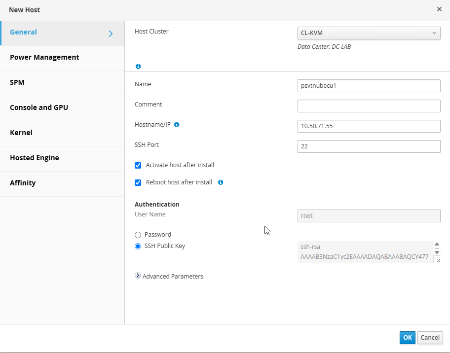
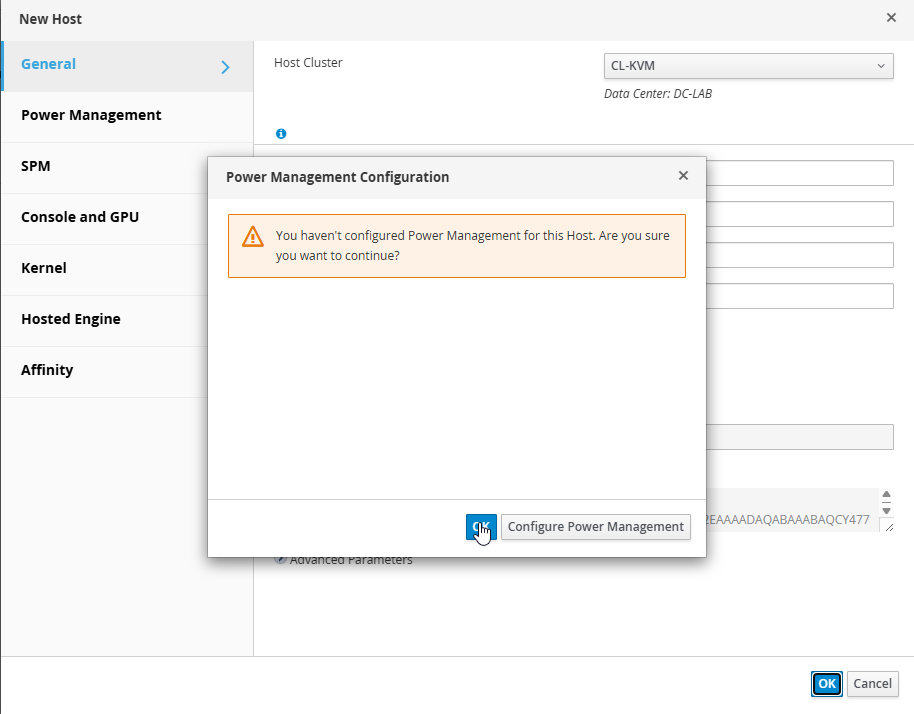

OLVM connects to the KVM host using SSH public-key authentication and deploys the required virtualization management components.

Monitor the host under **Compute → Hosts** until it reaches **Up** status.

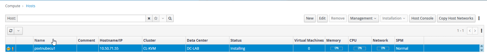

> **Note**
>
> During deployment, the host may temporarily display `Installing`, `Reboot`, or `Non Operational`. If deployment fails, review the events displayed in the OLVM Administration Portal and the host installation logs.

### Step 5: Verify the Registered KVM Host

Once deployment is complete, verify the following information in the OLVM Administration Portal:

| Component | Expected Result |
| --- | --- |
| Host | `psvtnubecu1` |
| Data Center | `DC-LAB` |
| Cluster | `CL-KVM` |
| Host Status | `Up` |
| Host Management Network | `ovirtmgmt` |
| Operating System | Supported Oracle Linux 9 release |
| Kernel | UEK R8 |

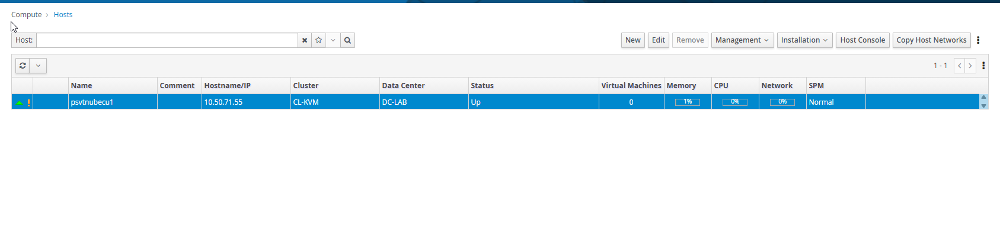

The KVM host is now registered with OLVM.

Virtual machines can be deployed after the required shared storage domains and virtual machine networks have been configured.

### Step 6: Prepare Shared iSCSI Storage

After the KVM host reaches **Up** status, configure the dedicated storage network before creating the shared iSCSI Data Domain.

The environment uses a ZFS Storage Appliance to provide shared block storage to the OLVM KVM hosts.

| Parameter | Value |
| --- | --- |
| Storage Appliance | `100.66.71.25` |
| Storage Protocol | iSCSI |
| Port | TCP `3260` |
| Storage Domain Name | `default_domain` |
| LUN Capacity | 1 TB |
| LUN GUID | `600144F0EB1FAD90000063E0F0B60007` |

#### Step 6.1: Review the Dedicated iSCSI Network

The physical servers use separate network interfaces for OLVM management and iSCSI storage traffic.

| Host | Management Interface | Management IP | iSCSI Interface | iSCSI IP |
| --- | --- | --- | --- | --- |
| `psvtnubecu1` | NET 0 | `10.50.71.55/24` | NET 1 | `100.66.71.55/24` |
| `psvtnubecu2` | NET 0 | `10.50.71.56/24` | NET 1 | `100.66.71.56/24` |

The network configuration is:

| Parameter | Management Network | iSCSI Network |
| --- | --- | --- |
| VLAN | 71 (untagged) | 666 (untagged) |
| MTU | 1500 | 9000 |
| Gateway | `10.50.71.1` | None |
| Purpose | OLVM management | Shared block storage |

The iSCSI network uses a dedicated subnet, `100.66.71.0/24`. Storage traffic must use this network rather than the OLVM management gateway.

Because VLAN 666 is configured as **untagged** on the switch port, no VLAN subinterface is required on the KVM host.

#### Step 6.2: Identify the Physical Network Interface

On `psvtnubecu1`, inspect the network interfaces:

```bash
[root@psvtnubecu1 ~]# ip -br addr
ip route
ip route get 100.66.71.25
lo               UNKNOWN        127.0.0.1/8 ::1/128
ens2f0           DOWN
ens2f1           DOWN
eno1             UP
eno2             UP
eno3             DOWN
eno4             DOWN
ibs3             DOWN
ibs3d1           DOWN
ovirtmgmt        UP             10.50.71.55/24 fe80::210:e0ff:fe68:8e20/64
;vdsmdummy;      DOWN
default via 10.50.71.1 dev ovirtmgmt proto static
10.50.71.0/24 dev ovirtmgmt proto kernel scope link src 10.50.71.55 metric 425
100.66.71.25 via 10.50.71.1 dev ovirtmgmt src 10.50.71.55 uid 0
    cache
```

The management IP address is assigned to the `ovirtmgmt` Linux bridge, which is managed by OLVM.

Inspect the NetworkManager devices and connection profiles:

```bash
[root@psvtnubecu1 ~]# nmcli device status
DEVICE       TYPE        STATE                   CONNECTION
ovirtmgmt    bridge      connected               ovirtmgmt
eno1         ethernet    connected               eno1
lo           loopback    connected (externally)  lo
eno2         ethernet    disconnected            --
eno3         ethernet    disconnected            --
eno4         ethernet    disconnected            --
ens2f0       ethernet    disconnected            --
ens2f1       ethernet    disconnected            --
ibs3         infiniband  disconnected            --
ibs3d1       infiniband  disconnected            --
;vdsmdummy;  bridge      unmanaged               --
```

Verify the physical link:

```bash
[root@psvtnubecu1 ~]# ethtool eno2 | grep -E 'Speed:|Link detected:'
GENERAL.DEVICE:                         eno2
GENERAL.CONNECTION:                     --
GENERAL.HWADDR:                         00:10:E0:68:8E:21
        Speed: 10000Mb/s
        Link detected: yes
```

Confirm that `eno2` corresponds to the physical NET 1 connection on the storage switch before proceeding.

> **Important**
>
> Do not modify the existing `ovirtmgmt` bridge or its management IP address. The dedicated iSCSI network must be configured separately.

#### Step 6.3: Create the iSCSI NetworkManager Connection

Once `eno2` has been confirmed as the dedicated storage interface, create a persistent NetworkManager connection.

The required settings are:

| Parameter | Value |
| --- | --- |
| Connection Name | `iscsi-net` |
| Interface | `eno2` |
| IPv4 Address | `100.66.71.55/24` |
| MTU | `9000` |
| Default Gateway | None |
| IPv6 | Disabled |
| Autoconnect | Enabled |

Create the connection:

```bash
[root@psvtnubecu1 ~]# nmcli connection add \
  type ethernet \
  con-name iscsi-net \
  ifname eno2 \
  ipv4.method manual \
  ipv4.addresses 100.66.71.55/24 \
  ipv6.method disabled \
  802-3-ethernet.mtu 9000 \
  connection.autoconnect yes
Connection 'iscsi-net' (8662b93c-bef3-4361-b6d3-ace56f762b3f) successfully added.
```

Activate the connection:

```bash
[root@psvtnubecu1 ~]# nmcli connection up iscsi-net
Connection successfully activated (D-Bus active path: /org/freedesktop/NetworkManager/ActiveConnection/13)
```

The connection is stored persistently by NetworkManager and configured to activate automatically after a reboot.

> **Note**
>
> The command assumes that `eno2` is not already managed by another connection profile. If an existing profile is present, modify that profile instead of creating a conflicting connection.
>
> On an OLVM-managed host, coordinate network changes with the OLVM network configuration to avoid inconsistencies during future host network operations.

#### Step 6.4: Verify the iSCSI Interface Configuration

Check the assigned IP address:

```bash
[root@psvtnubecu1 ~]# ip -br addr show eno2
eno2             UP             100.66.71.55/24
```

Verify the interface MTU:

```bash

[root@psvtnubecu1 ~]# ip link show eno2
5: eno2: <BROADCAST,MULTICAST,UP,LOWER_UP> mtu 9000 qdisc mq state UP mode DEFAULT group default qlen 1000
    link/ether 00:10:e0:68:8e:21 brd ff:ff:ff:ff:ff:ff
    altname enp58s0f1
```

Verify the route to the storage appliance:

```bash
[root@psvtnubecu1 ~]# ip route get 100.66.71.25
100.66.71.25 dev eno2 src 100.66.71.55 uid 0
    cache
```

This confirms that traffic to the storage appliance uses the dedicated iSCSI interface rather than the management gateway.

#### Step 6.5: Verify Storage Network Connectivity

Test connectivity to the ZFS Storage Appliance:

```bash

[root@psvtnubecu1 ~]# ping -I eno2 -c 3 100.66.71.25
PING 100.66.71.25 (100.66.71.25) from 100.66.71.55 eno2: 56(84) bytes of data.
64 bytes from 100.66.71.25: icmp_seq=1 ttl=255 time=0.090 ms
64 bytes from 100.66.71.25: icmp_seq=2 ttl=255 time=0.112 ms
64 bytes from 100.66.71.25: icmp_seq=3 ttl=255 time=0.094 ms

--- 100.66.71.25 ping statistics ---
3 packets transmitted, 3 received, 0% packet loss, time 2034ms
rtt min/avg/max/mdev = 0.090/0.098/0.112/0.009 ms
```

For an IPv4 network with MTU 9000, the ICMP payload size is 8972 bytes.

The complete network path, including the physical switch ports and ZFS appliance, must support jumbo frames.

Check TCP connectivity to the iSCSI service:

```bash
[root@psvtnubecu1 ~]# nc -zv -w 5 100.66.71.25 3260
Ncat: Version 7.92 ( https://nmap.org/ncat )
Ncat: Connected to 100.66.71.25:3260.
Ncat: 0 bytes sent, 0 bytes received in 0.01 seconds.
```

Successful TCP connectivity confirms that the storage endpoint is reachable. It does not verify iSCSI initiator authorization, CHAP authentication, or LUN presentation.

#### Step 6.6: Verify iSCSI Initiator Configuration

The iSCSI initiator identifiers and authentication information are maintained in PasswordSafe.

Display the local initiator IQN:

```bash
[root@psvtnubecu1 ~]# cat /etc/iscsi/initiatorname.iscsi
InitiatorName=iqn.1994-05.com.redhat:fe78587fff1a
```

Verify that the initiator is authorized to access the ZFS iSCSI target.

> **Important**
>
> The KVM host acts as an iSCSI initiator and normally does not require an inbound firewall rule for TCP port `3260`.
>
> Do not manually partition or format the iSCSI LUN. OLVM manages storage domain initialization.

## Add the Second KVM Host

The second KVM host, `psvtnubecu2`, is installed using the same procedure described for the first KVM host, `psvtnubecu1`.

Both hosts are registered in the same OLVM cluster, `CL-KVM`, and will access the same shared iSCSI Data Domain.

### Step 1: Prepare the Second KVM Host

The second host uses the following configuration:

| Parameter | Value |
| --- | --- |
| Hostname | `psvtnubecu2` |
| Operating System | Oracle Linux 9.8 |
| Management IP | `10.50.71.56/24` |
| Management VLAN | 71 (untagged) |
| Management Gateway | `10.50.71.1` |
| iSCSI IP | `100.66.71.56/24` |
| iSCSI VLAN | 666 (untagged) |
| iSCSI MTU | 9000 |
| Data Center | `DC-LAB` |
| Cluster | `CL-KVM` |

Follow the same host preparation procedure used for `psvtnubecu1`, including:

1. Installing and configuring Oracle Linux 9.8.
2. Configuring hostname, DNS, and management networking.
3. Enabling the required Oracle Linux virtualization repositories.
4. Ensuring that the host has Internet access to download the required packages.
5. Running the OLVM host prerequisite checks.
6. Preparing SSH public-key authentication for OLVM.

The second host must meet the same prerequisites as the first host.

### Step 2: Register the Host in OLVM

In the OLVM Administration Portal, navigate to:

**Compute → Hosts → New**

Use the following settings:

| Field | Value |
| --- | --- |
| Name | `psvtnubecu2` |
| Hostname/IP | `10.50.71.56` |
| Data Center | `DC-LAB` |
| Cluster | `CL-KVM` |
| SSH Port | `22` |
| Authentication | SSH Public Key |

Install the OLVM Engine's SSH public key on `psvtnubecu2` using the same procedure described for the first KVM host.

Start the installation and wait until the host status changes to **Up**.

Both KVM hosts should then be visible under **Compute → Hosts**.

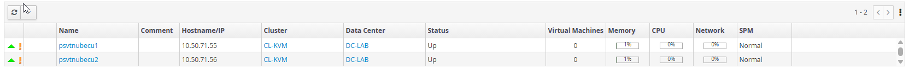

### Step 3: Configure the Dedicated iSCSI Network

Configure the second host's dedicated iSCSI interface using the same NetworkManager procedure described in **Step 6: Prepare Shared iSCSI Storage** for the first host.

The host-specific difference is the iSCSI IP address.

| Parameter | KVM Host 1 | KVM Host 2 |
| --- | --- | --- |
| Host | `psvtnubecu1` | `psvtnubecu2` |
| iSCSI IP | `100.66.71.55/24` | `100.66.71.56/24` |
| VLAN | 666 (untagged) | 666 (untagged) |
| MTU | 9000 | 9000 |
| Storage Target | `100.66.71.25` | `100.66.71.25` |

Verify the physical interface corresponding to NET 1 before applying the configuration.

After configuring the connection, verify routing and connectivity:

```bash
[root@psvtnubecu2 ~]# ip route get 100.66.71.25
100.66.71.25 dev eno2 src 100.66.71.56 uid 0
    cache

[root@psvtnubecu2 ~]# ping -c 3 100.66.71.25
PING 100.66.71.25 (100.66.71.25) 56(84) bytes of data.
64 bytes from 100.66.71.25: icmp_seq=1 ttl=255 time=0.113 ms
64 bytes from 100.66.71.25: icmp_seq=2 ttl=255 time=0.112 ms
64 bytes from 100.66.71.25: icmp_seq=3 ttl=255 time=0.107 ms

--- 100.66.71.25 ping statistics ---
3 packets transmitted, 3 received, 0% packet loss, time 2078ms
rtt min/avg/max/mdev = 0.107/0.110/0.113/0.002 ms

[root@psvtnubecu2 ~]# nc -zv -w 5 100.66.71.25 3260
Ncat: Version 7.92 ( https://nmap.org/ncat )
Ncat: Connected to 100.66.71.25:3260.
Ncat: 0 bytes sent, 0 bytes received in 0.01 seconds.
```

The route must use the dedicated iSCSI interface and source address `100.66.71.56`.

### Step 4: Verify the iSCSI Initiator

Each KVM host has its own iSCSI initiator IQN.

Display the initiator IQN on the second host:

```bash
[root@psvtnubecu2 ~]# cat /etc/iscsi/initiatorname.iscsi
InitiatorName=iqn.1994-05.com.redhat:e2365ef465a
```

Record the IQN and ensure that both KVM hosts are authorized on the ZFS Storage Appliance.

### Configure Shared Storage

Once both KVM hosts are installed and their dedicated iSCSI networks are operational, prepare the hosts for access to the shared iSCSI Data Domain.

**The default iSCSI initiator IQNs generated during Oracle Linux installation must be adjusted to match the initiator identities already configured on the ZFS Storage Appliance.**

The required initiator IQNs are:

| KVM Host | Required Initiator IQN |
| --- | --- |
| `psvtnubecu1` | `iqn.1995-10.com.example:psvtnubecu1` |
| `psvtnubecu2` | `iqn.1995-10.com.example:psvtnubecu2` |

On each KVM host, back up the existing configuration:

```bash
cp -a /etc/iscsi/initiatorname.iscsi \
  /etc/iscsi/initiatorname.iscsi.bak
```

Edit the initiator configuration:

```bash
vi /etc/iscsi/initiatorname.iscsi
```

On **`psvtnubecu1`**, configure:

```ini
InitiatorName=iqn.1995-10.com.example:psvtnubecu1
```

On **`psvtnubecu2`**, configure:

```ini
InitiatorName=iqn.1995-10.com.example:psvtnubecu2
```

After saving the configuration, check for existing iSCSI sessions:

```bash
iscsiadm -m session
```

If no active storage workloads depend on iSCSI, restart the iSCSI services on each host:

```bash
systemctl restart iscsid
systemctl restart iscsi
```

> **Important**
>
> Existing iSCSI sessions may need to be disconnected and re-established for the new initiator IQN to take effect. Restarting the services alone does not guarantee that an existing session adopts the new identity.
>
> Perform these changes before creating the shared OLVM Data Domain. Do not interrupt sessions used by active storage workloads.

Verify the configured initiator IQN:

```bash
[root@psvtnubecu1 ~]# cat /etc/iscsi/initiatorname.iscsi
InitiatorName=iqn.1995-10.com.example:psvtnubecu1
[root@psvtnubecu2 ~]# cat /etc/iscsi/initiatorname.iscsi
InitiatorName=iqn.1995-10.com.example:psvtnubecu2
```

The Oracle ZFS Storage Appliance provides the following shared storage:

| Parameter | Value |
| --- | --- |
| Storage Appliance | `100.66.71.25` |
| Protocol | iSCSI |
| Port | TCP `3260` |
| Project | `labor` |
| LUN | `default_domain` |
| Capacity | 1 TB |
| Target IQN | `iqn.1995-10.com.example:labor` |
| Target Group | `labor_targets` |
| Initiator Group | `labor_hosts` |
| LUN GUID | `600144F0EB1FAD90000063E0F0B60007` |

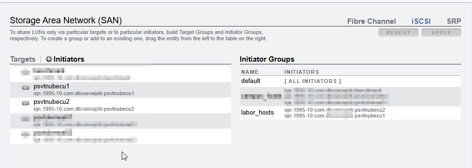

Both KVM host initiators must be members of the `labor_hosts` initiator group to access the shared LUN.

After verifying the initiator configuration and storage access, navigate to **Storage → Domains → New Domain** in the OLVM Administration Portal.

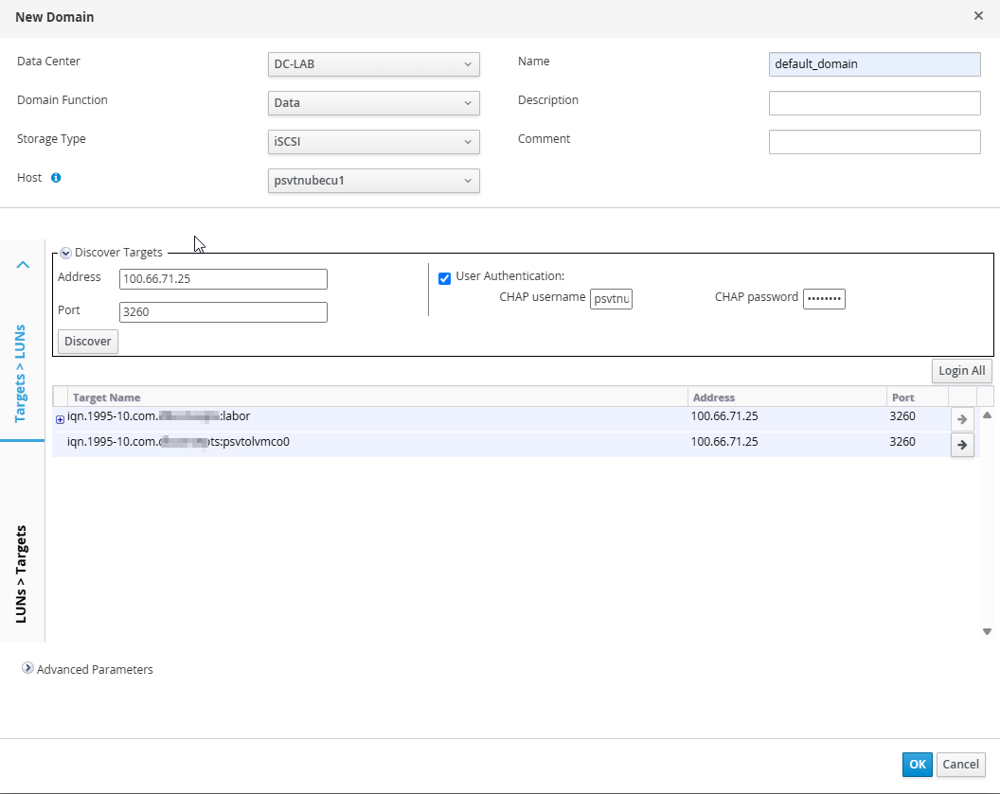
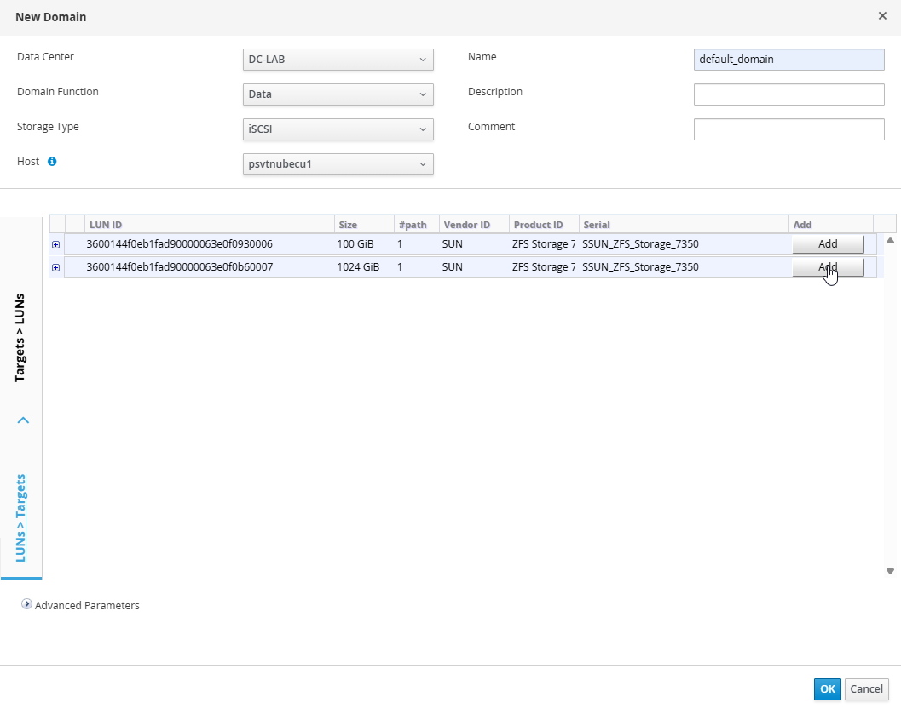
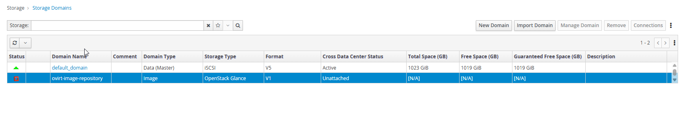

The shared Data Domain is created **once in OLVM**, not separately for each KVM host.

> **Important**
>
> Each KVM host must use a unique initiator IQN matching its authorized identity on the ZFS Storage Appliance.
>
> Do not manually partition or format the iSCSI LUN. OLVM manages storage domain initialization.

### Verify the Data Center and Shared Storage

After successfully creating and attaching the shared iSCSI Data Domain `default_domain`, the OLVM Data Center `DC-LAB` transitions to **Up** status.

The environment now consists of:

| Component | Name | Expected Status |
| --- | --- | --- |
| Data Center | `DC-LAB` | Up |
| Cluster | `CL-KVM` | Operational |
| KVM Host 1 | `psvtnubecu1` | Up |
| KVM Host 2 | `psvtnubecu2` | Up |
| iSCSI Data Domain | `default_domain` | Active |

Verify the configuration in the OLVM Administration Portal:

1. Navigate to **Compute → Data Centers** and confirm that `DC-LAB` has status **Up**.

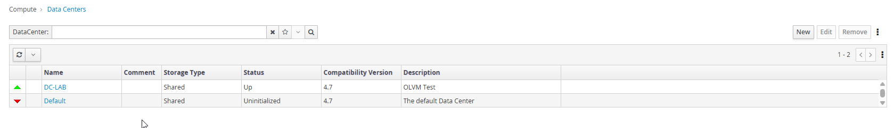

2. Navigate to **Compute → Hosts** and verify that both KVM hosts have status **Up**.


3. Navigate to **Storage → Domains** and confirm that `default_domain` is **Active** and attached to `DC-LAB`.


The shared iSCSI storage is now available for virtual machine disks and other supported storage operations.

### Final Step: Test the Storage Connection by Uploading an ISO Image

As a final validation, upload an ISO image to the shared Data Domain.

This verifies that the OLVM Engine can communicate with the virtualization hosts and that the storage domain is available for image uploads.

#### Step 1: Prepare an ISO Image

Download or prepare an installation ISO, for example an Oracle Linux installation image, on the workstation used to access the OLVM Administration Portal.

#### Step 2: Upload the ISO Image

In the OLVM Administration Portal:

1. Navigate to **Storage → Disks**.
2. Select **Upload → Start**.
3. Choose the ISO image from the local workstation.
4. Select the `default_domain` storage domain.
5. Click **Test Connection** to verify that the upload connection is working correctly.
6. Once the connection test succeeds, click **OK** to start the upload.
7. Monitor the upload progress until the ISO image is successfully transferred.

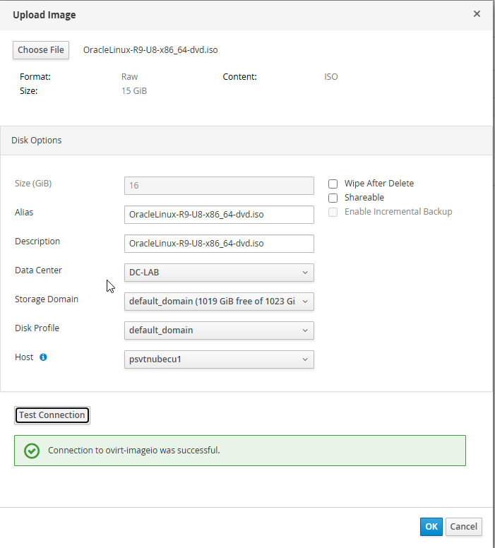
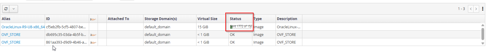

> **Note**
>
> The **Test Connection** function verifies connectivity to the image upload service before transferring the ISO file. If the test fails, check the `ovirt-imageio` service, HTTPS certificate trust, and network connectivity before proceeding.

#### Step 3: Verify the Upload
 
After the upload completes, verify that the ISO image has been successfully transferred to the shared storage domain.

1. Navigate to **Storage → Disks** in the OLVM Administration Portal.
2. Locate the uploaded ISO image in the disk list.
3. Verify that its status is **OK**.
4. Confirm that the image is stored in the `default_domain` storage domain.

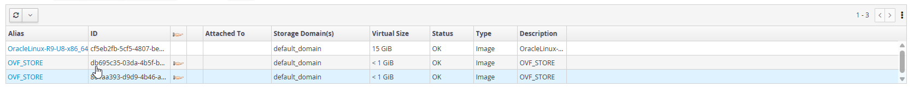

A successful upload confirms that the OLVM image upload service is operational and that the shared iSCSI Data Domain can accept image data.

The uploaded ISO image can now be attached to a virtual machine as a virtual CD-ROM for operating system installation.

## Summary

The Oracle Linux Virtualization Manager (OLVM) 4.5.5 environment has been successfully deployed using a standalone Manager, two Oracle Linux KVM hosts, and shared iSCSI storage provided by an Oracle ZFS Storage Appliance.

The deployment includes the following components:

| Component | Configuration |
| --- | --- |
| Virtualization Manager | Oracle Linux Virtualization Manager 4.5.5 |
| Deployment Type | Standalone Engine |
| Operating System | Oracle Linux 9.8 |
| OLVM Engine | `labor.lab.example.at` |
| Data Center | `DC-LAB` |
| Cluster | `CL-KVM` |
| KVM Host 1 | `psvtnubecu1.lab.example.at` |
| KVM Host 2 | `psvtnubecu2.lab.example.at` |
| Shared Storage | Oracle ZFS Storage Appliance |
| Storage Protocol | iSCSI |
| Storage Network | VLAN 666, MTU 9000 |
| Data Storage Domain | `default_domain` |
| Storage Capacity | 1 TB |

### Deployment Verification

The following configuration and validation tasks have been completed:

1. Installed and configured the standalone OLVM Engine.
2. Created the `DC-LAB` Data Center and `CL-KVM` virtualization cluster.
3. Installed and registered both Oracle Linux KVM hosts.
4. Configured dedicated iSCSI networking on both hosts.
5. Configured the iSCSI initiator identities to match the authorized initiators on the ZFS Storage Appliance.
6. Configured and attached the shared `default_domain` iSCSI Data Domain.
7. Verified that the Data Center and both KVM hosts report **Up** status.
8. Verified that the shared Data Domain reports **Active** status.
9. Validated the image upload connection and uploaded an ISO image to the shared storage domain.

### Result

The OLVM environment is operational, with both KVM hosts managed centrally through the OLVM Administration Portal and connected to a common shared storage domain.

The successful ISO image upload confirms that the image transfer service can access and write data to the configured storage domain.

The infrastructure is now prepared for virtual machine provisioning, operating system installation, and further validation of virtual machine operations.

> **Note**
>
> A successful ISO upload verifies basic storage write functionality. Additional validation, including virtual machine creation, startup, migration between KVM hosts, and recovery testing, should be performed before the environment is considered ready for production workloads.